<p align="center">
  
</p>

<h1 align="center">SMS Givolettese</h1>

<p align="center">
  Il sito e il gestionale della <strong>Società di Mutuo Soccorso Givolettese</strong> (Givoletto, dal 1882).<br>
  Un sito pubblico pensato per le persone anziane e un'area riservata per staff e volontari.
</p>

<p align="center">
  <a href="https://smsgivolettese.vercel.app">Sito pubblico</a> ·
  <a href="#2-il-sito-pubblico">Manuale</a> ·
  <a href="#9-per-chi-sviluppa">Per chi sviluppa</a>
</p>

<p align="center">
  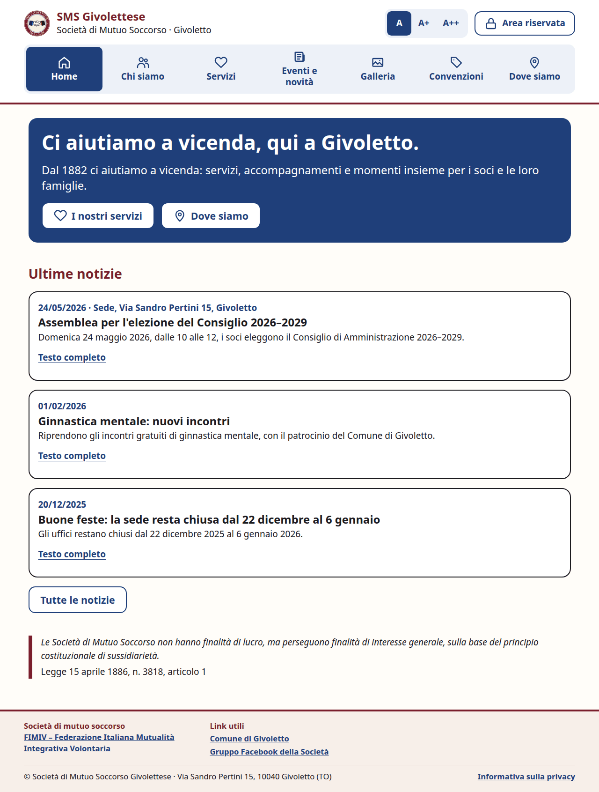
</p>

---

## Che cos'è

Una sola piattaforma per tre cose:

- **Il sito pubblico.** Racconta chi siamo, i servizi, le convenzioni, gli eventi e la galleria fotografica. Testi grandi, pulsanti grandi, tre misure di carattere. Nessun prezzo, nessun numero di telefono: è una vetrina.
- **L'agenda dei volontari.** Ogni volontario indica quando è libero, vede i suoi turni e i suoi trasporti, li conferma con un tocco e chiude il viaggio con i chilometri.
- **Il gestionale dello staff.** Trasporti, turni, libro soci con quote, fatture con PDF ed export per il commercialista, bacheca delle notizie e modifica dei testi del sito. Senza toccare una riga di codice.

Chi entra vede solo quello che gli serve:

| Ruolo | Cosa può fare |
|---|---|
| **Visitatore** | Legge il sito, propone una notizia. |
| **Volontario** | *I miei impegni* (turni e trasporti), *Le mie disponibilità*, cambio password. |
| **Staff** | Tutto il gestionale: trasporti, turni, soci, volontari, fatture, servizi, mezzi, impostazioni, bacheca, testi del sito. |
| **Super admin** | Come lo staff, più *Utenti e ruoli*, *Registro attività*, esportazione e cancellazione dei dati personali (GDPR), autenticazione a due fattori. |

> Le immagini di questo manuale vengono dalla copia locale con i **dati di esempio**: ogni nome che finisce con "(esempio)" è finto.

---

## Indice

1. [Primo accesso](#1-primo-accesso)
2. [Il sito pubblico](#2-il-sito-pubblico)
3. [Guida per i volontari](#3-guida-per-i-volontari)
4. [Guida per lo staff: il pannello](#4-guida-per-lo-staff-il-pannello)
   - [Trasporti](#41-trasporti) · [Turni](#42-turni) · [Disponibilità volontari](#43-disponibilità-volontari)
5. [Persone: soci e volontari](#5-persone-soci-e-volontari)
6. [Amministrazione: fatture, servizi, mezzi, impostazioni](#6-amministrazione)
7. [Sito: bacheca, proposte e testi delle pagine](#7-sito-bacheca-proposte-e-testi)
8. [Guida per il super admin](#8-guida-per-il-super-admin)
9. [Per chi sviluppa](#9-per-chi-sviluppa)
10. [Domande frequenti](#10-domande-frequenti)

---

## 1. Primo accesso

Dal sito pubblico premi **Area riservata** in alto a destra. Si apre la pagina **Accedi**.

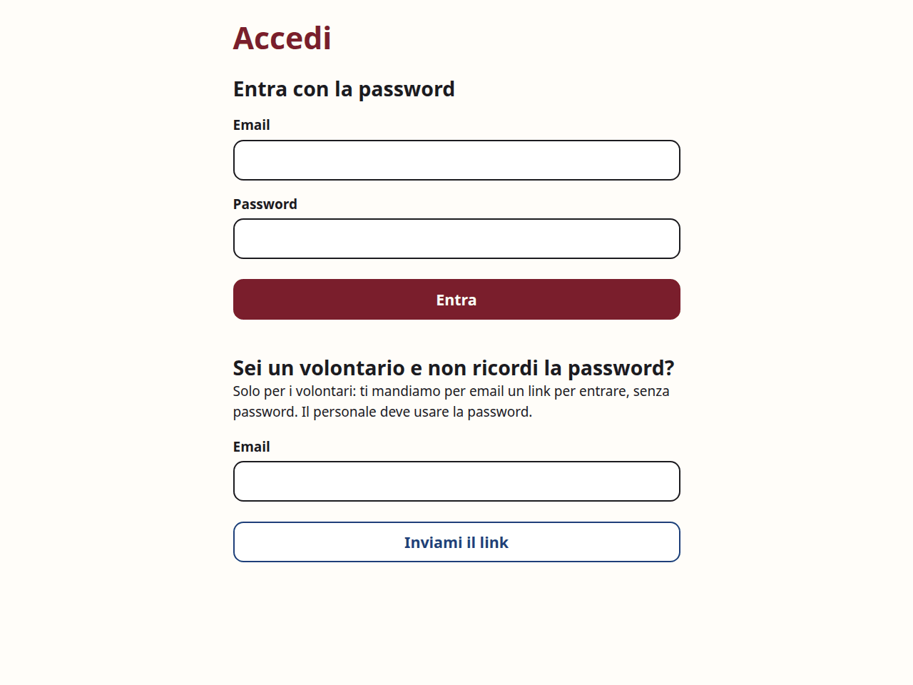

1. Scrivi la tua **email** e la tua **password**.
2. Premi **Entra**. Arrivi al tuo pannello.

**Non hai ancora una password?** Nessuno si registra da solo. Lo staff ti invita (o il super admin, se sei staff): ricevi un'email con un link, lo apri e scegli la password nella pagina **Imposta la password** (almeno 12 caratteri).

**Sei un volontario e non ricordi la password?** Usa il riquadro sotto, *Sei un volontario e non ricordi la password?*: scrivi la tua email e premi **Inviami il link**. Ti arriva un link per entrare senza password. Questo riquadro vale solo per i volontari: lo staff entra sempre con la password.

**Cambiare la password.** Apri il menu con il tuo nome in alto a destra e scegli **Cambia password**.

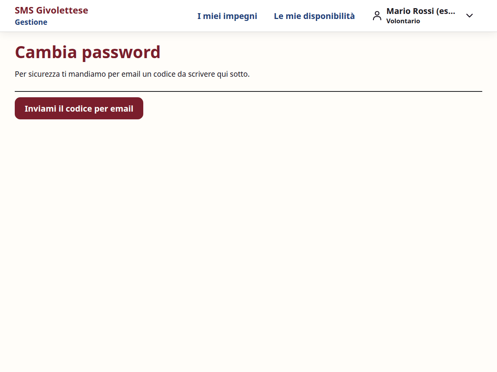

**Uscire.** Dal menu con il tuo nome, **Esci**.

---

## 2. Il sito pubblico

Il sito è fatto per essere letto facilmente da tutti, anche da telefono.

### Il menu e la misura del testo

In alto c'è il menu a pulsanti grandi: **Home**, **Chi siamo**, **Servizi**, **Eventi e novità**, **Galleria**, **Convenzioni**, **Dove siamo**. I pulsanti **A**, **A+**, **A++** ingrandiscono tutto il testo; il sito si ricorda la scelta anche alla visita successiva.

<table>
<tr>
<td width="50%">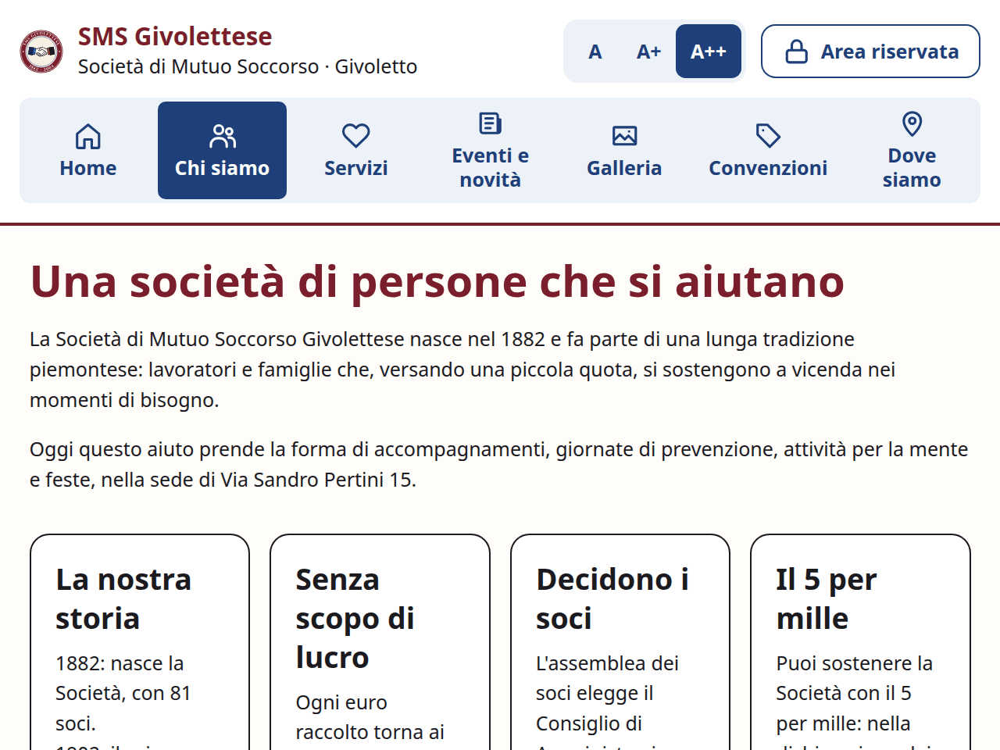</td>
<td width="50%" align="center">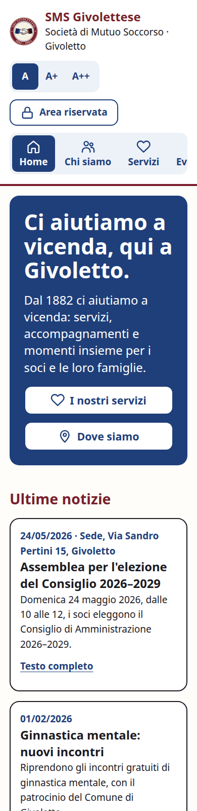</td>
</tr>
<tr>
<td><em>Con <strong>A++</strong> il testo diventa molto più grande.</em></td>
<td align="center"><em>Lo stesso sito sul telefono.</em></td>
</tr>
</table>

### Le pagine

| Pagina | Cosa contiene |
|---|---|
| **Home** | Il saluto, i prossimi eventi (o le ultime notizie se non ci sono eventi in arrivo) e la galleria. |
| **Chi siamo** | La storia della Società, come funziona, il 5 per mille. |
| **Servizi** | I servizi offerti ai soci, con quando si svolgono. |
| **Eventi e novità** | Tutti gli articoli, con i filtri *Eventi*, *Avvisi*, *Notizie*. |
| **Galleria** | Le foto di copertina degli articoli pubblicati. |
| **Convenzioni** | Gli accordi con altri enti, con i link. |
| **Dove siamo** | L'indirizzo della sede. |
| **Informativa sulla privacy** | In fondo a ogni pagina. |

<table>
<tr>
<td width="50%">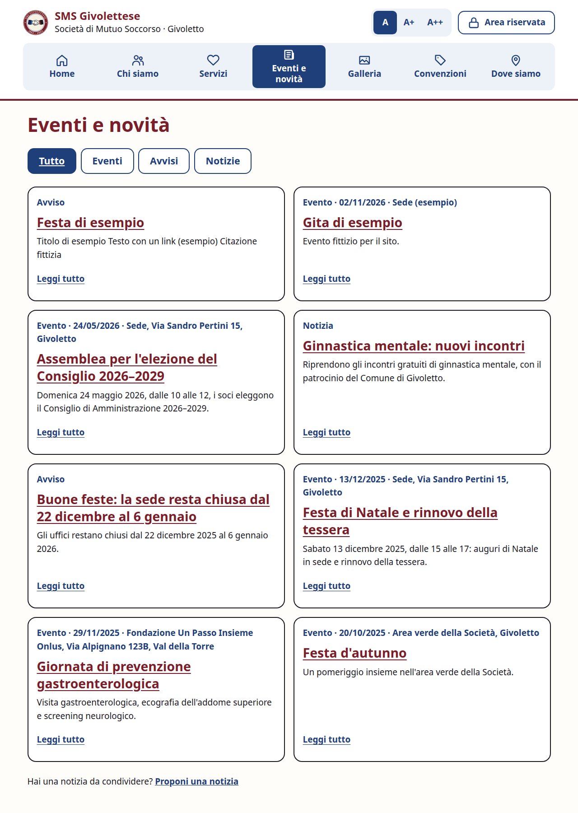</td>
<td width="50%">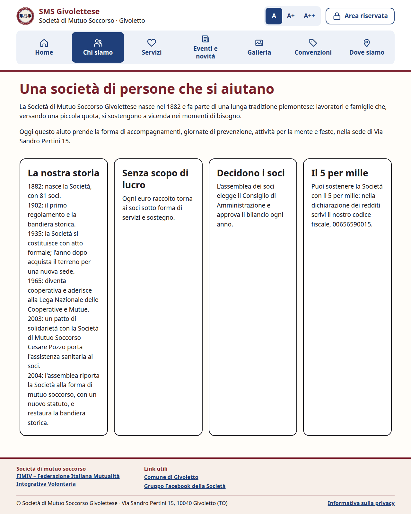</td>
</tr>
<tr>
<td><em>Eventi e novità, con i filtri.</em></td>
<td><em>Chi siamo.</em></td>
</tr>
<tr>
<td>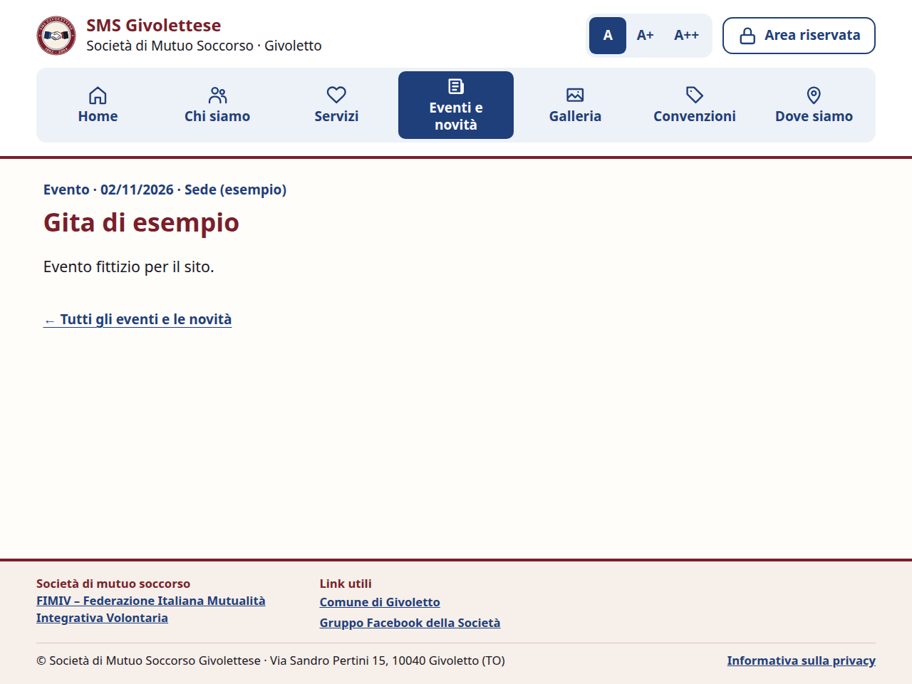</td>
<td>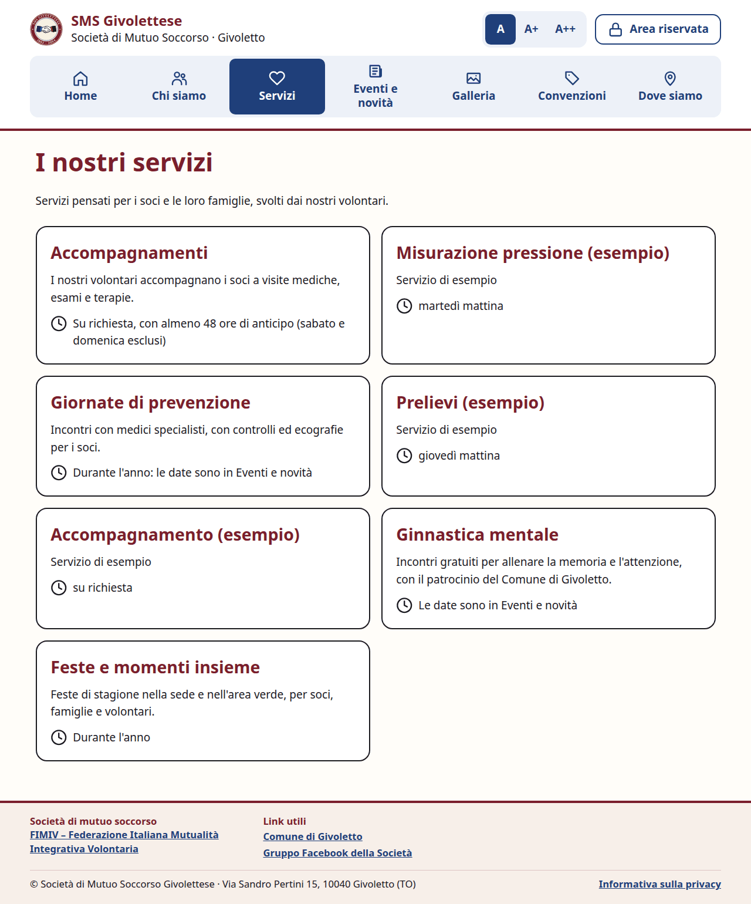</td>
</tr>
<tr>
<td><em>Un evento: data, luogo e testo completo.</em></td>
<td><em>Servizi.</em></td>
</tr>
<tr>
<td>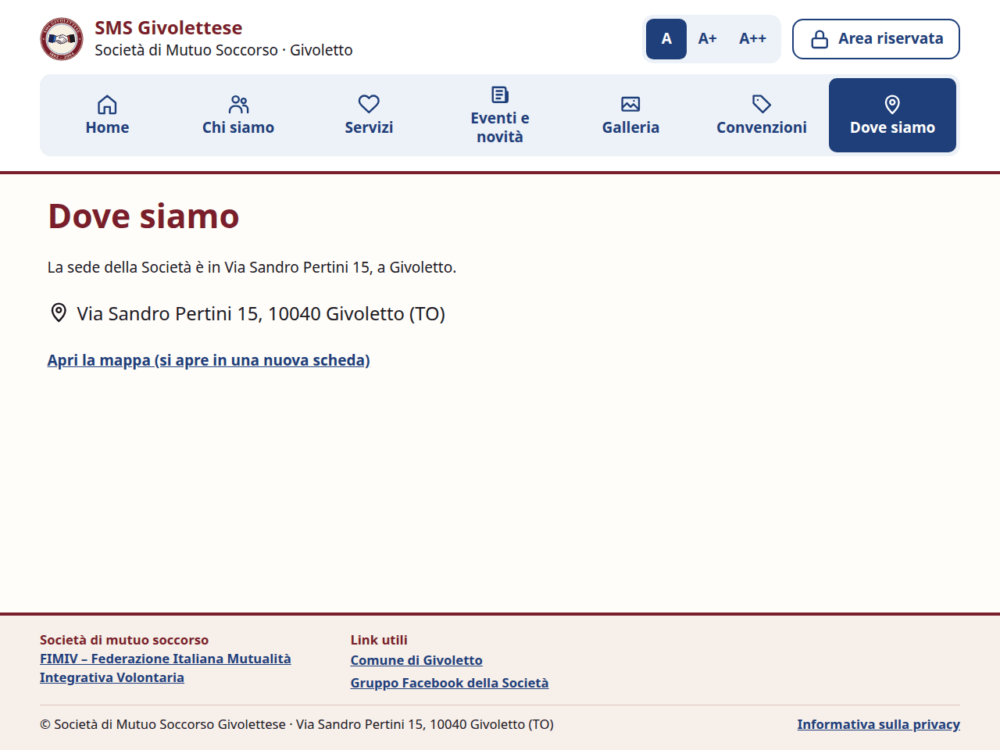</td>
<td>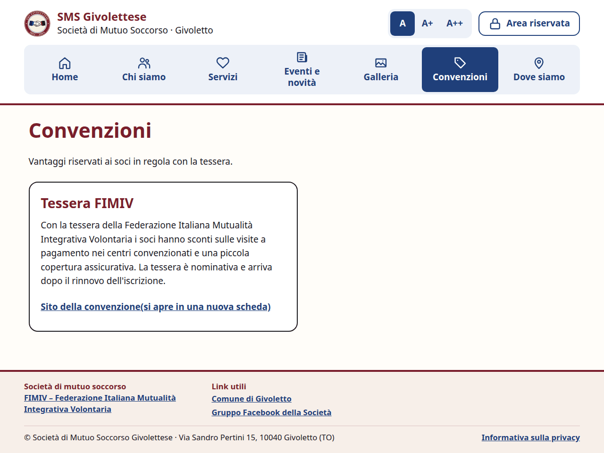</td>
</tr>
<tr>
<td><em>Dove siamo.</em></td>
<td><em>Convenzioni.</em></td>
</tr>
</table>

### Proporre una notizia

Chiunque può suggerire una notizia o un evento, senza account. In fondo a **Eventi e novità** premi **Proponi una notizia**, compila nome, titolo, tipo e testo (puoi aggiungere una foto o un link a un video). La proposta **non va online subito**: arriva allo staff, che la legge e decide (vedi [Proposte](#proposte-dal-pubblico)).

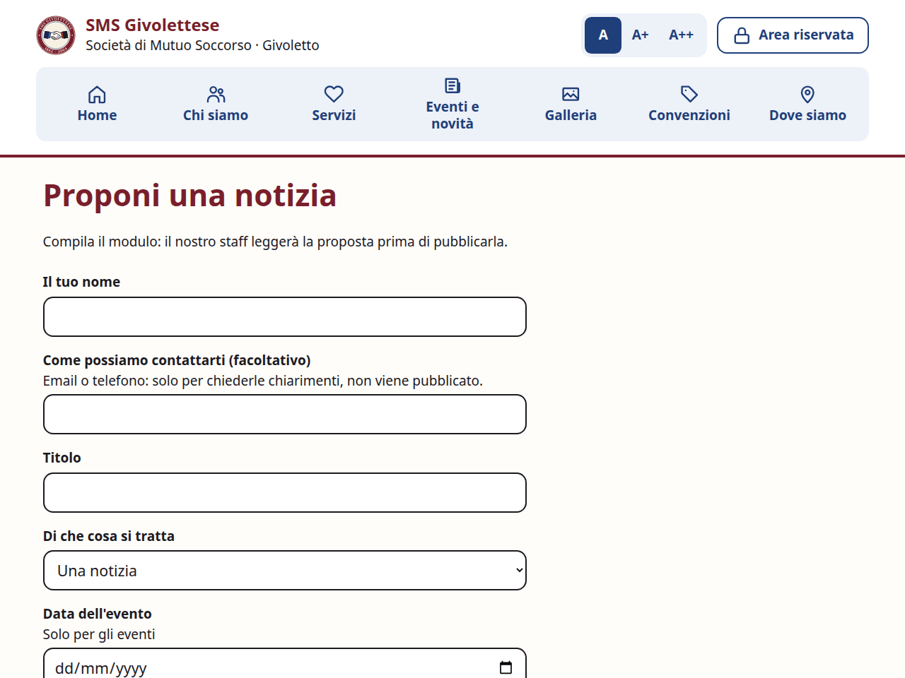

---

## 3. Guida per i volontari

Quando entri vedi due voci: **I miei impegni** e **Le mie disponibilità**. Funziona bene anche dal telefono.

### Dire quando sei libero

Apri **Le mie disponibilità**.

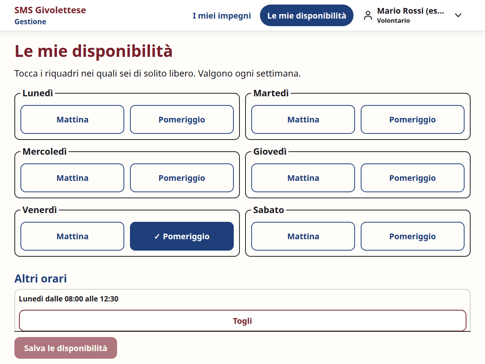

1. **Tocca i riquadri** *Mattina* o *Pomeriggio* dei giorni in cui di solito sei libero. Il riquadro scelto diventa blu con la spunta ✓. Valgono ogni settimana.
2. Se hai orari diversi, in **Altri orari** scegli il giorno, *Dalle*, *Alle* e premi **Aggiungi orario**. Per togliere un orario premi **Togli**.
3. Premi **Salva le disponibilità**. Se esci prima, la pagina ti avvisa che hai modifiche non salvate.

**Ferie o giorni no.** Nella sezione **Non ci sono** indica *Dal giorno* e *Al giorno* (e una nota se vuoi) e premi **Segna assenza**. In quei giorni lo staff ti vede come "assente" e non ti propone impegni.

> Nelle note non scrivere informazioni sulla salute, né tua né di altri.

### I miei impegni

È la tua agenda della settimana, da lunedì a sabato. Con le frecce **‹ ›** cambi settimana, con **Oggi** torni a quella corrente.

<table>
<tr>
<td width="65%">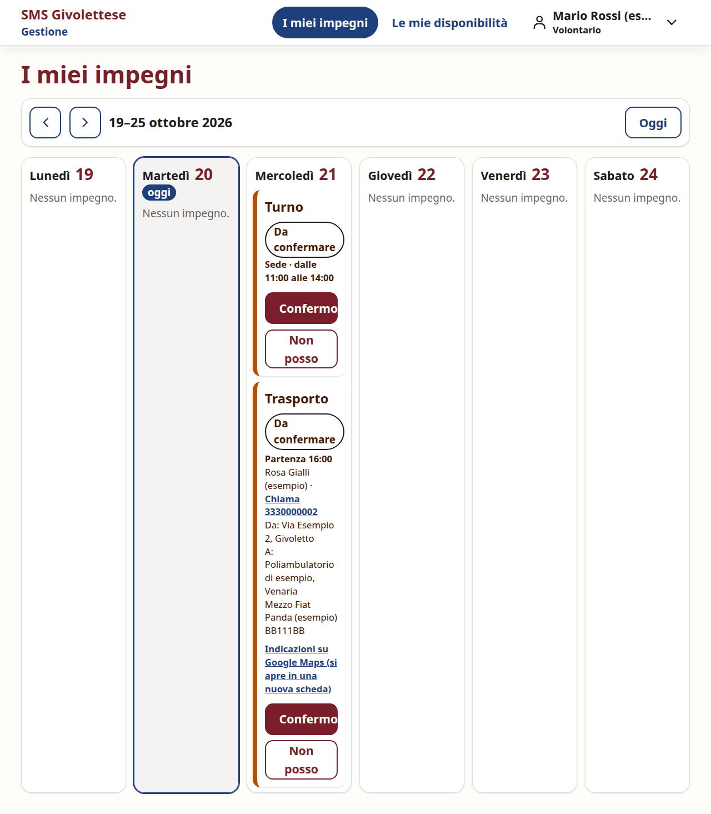</td>
<td width="35%" align="center">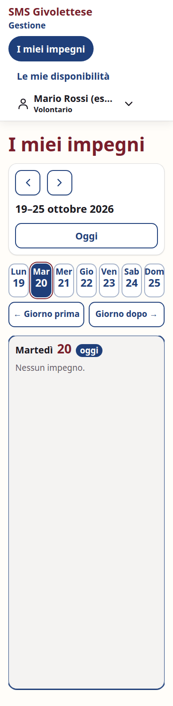</td>
</tr>
</table>

Ogni impegno è una scheda:

- **Turno**: il tipo (per esempio *Sede*) e l'orario.
- **Trasporto**: l'ora di partenza, il nome del socio con il pulsante **Chiama**, da dove a dove, il mezzo da usare e il link **Indicazioni su Google Maps**.

Quando lo staff ti assegna qualcosa ricevi un'email e la scheda dice **Da confermare**:

1. Premi **Confermo** se ci sei. La scheda diventa *Confermato*.
2. Premi **Non posso** se non puoi. Ti chiede conferma (**Sì, non posso**), poi lo staff riceve un avviso e cerca qualcun altro. Da qui non puoi più cambiare idea: se ci ripensi, chiama lo staff.

### Chiudere un trasporto

Dal giorno del viaggio, sulla scheda del trasporto compare la chiusura:

1. Scrivi i **chilometri del contachilometri alla partenza** e **all'arrivo**.
2. Se serve, aggiungi una nota (senza informazioni sulla salute).
3. Conferma. La scheda diventa **Svolto**: lo staff vede i km percorsi e può fare la fattura.

---

## 4. Guida per lo staff: il pannello

Dopo l'accesso arrivi al **Pannello di gestione**: due numeri da tenere d'occhio (*Turni scoperti questa settimana*, *Trasporti da assegnare*) e i pulsanti rapidi **Nuovo trasporto** e **Nuovo socio**.

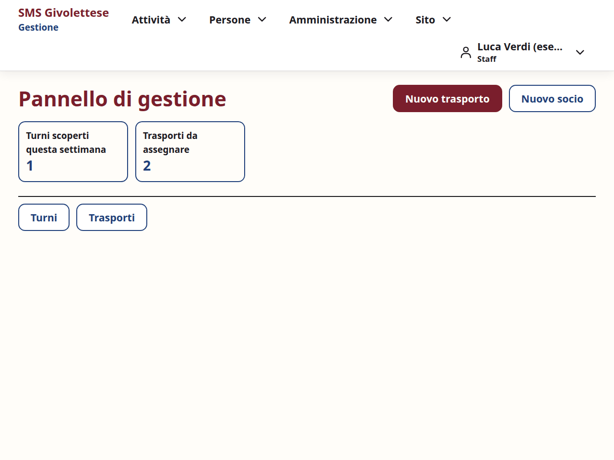

Il menu in alto ha quattro gruppi. Ogni voce ha una riga che spiega a cosa serve.

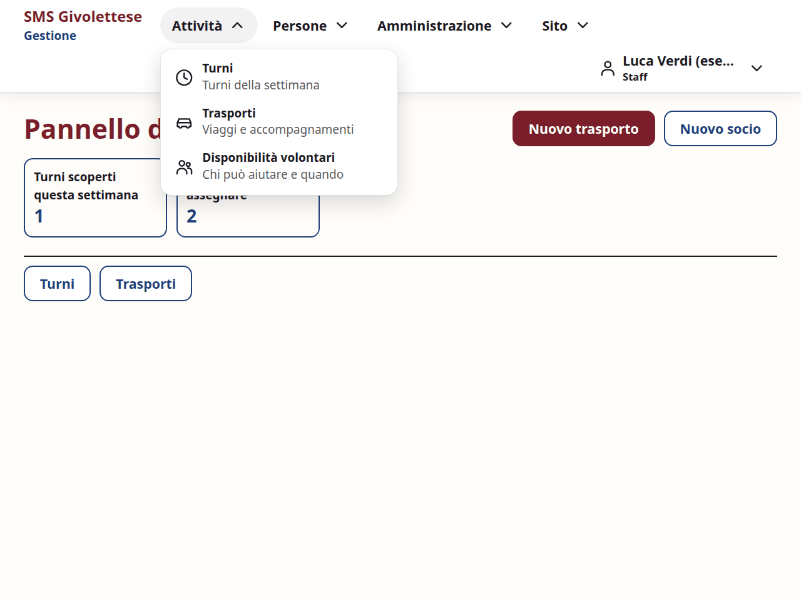

| Gruppo | Voci |
|---|---|
| **Attività** | Turni · Trasporti · Disponibilità volontari |
| **Persone** | Soci · Volontari |
| **Amministrazione** | Fatture · Servizi · Mezzi · Impostazioni |
| **Sito** | Bacheca · Modifica il sito |

Calendari, elenchi e schede usano sempre gli stessi gesti: frecce **‹ ›** e **Oggi** per le settimane, un pulsante principale colorato per l'azione più comune, **Altro ▾** per le azioni meno frequenti.

### 4.1 Trasporti

**Attività → Trasporti** mostra la settimana. Ogni trasporto è una scheda colorata con ora, socio, stato, partenza → destinazione e autista.

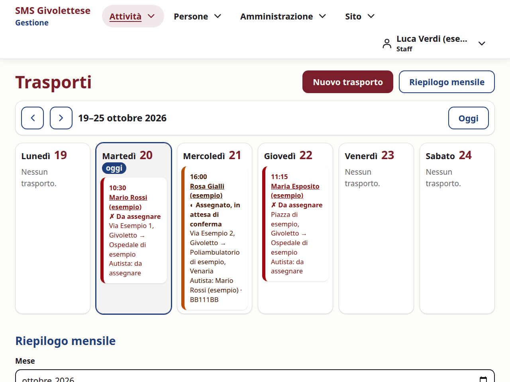

Gli stati di un trasporto:

| Stato | Significa |
|---|---|
| **Da assegnare** | Registrato, manca l'autista. |
| **Assegnato, in attesa di conferma** | L'autista ha ricevuto l'email, deve confermare. |
| **Confermato dall'autista** | Tutto pronto. |
| **Svolto** | Chiuso con i chilometri. Si può fatturare. |
| **Annullato** | Non si fa più. |

#### Registrare un trasporto

1. Premi **Nuovo trasporto** (dal pannello, dal calendario o dalla scheda di un socio).
2. **Scegli il socio**: cerca per nome, tessera, codice fiscale o telefono. Se non è ancora socio, premi **Nuovo socio** e registralo senza uscire dalla pagina. Indirizzo e telefono del socio si compilano da soli.
3. Indica **Data**, **Ora di partenza da casa** e/o **Ora dell'appuntamento** (almeno una delle due), eventualmente **Ora di ritorno**.
4. Controlla **Indirizzo di partenza**, **Destinazione**, **Telefono per contattare il socio**.
5. Spunta **Serve la carrozzina** o **Usa deambulatore o stampelle** se serve, e indica il **Numero di accompagnatori**.
6. Premi **Registra trasporto**.

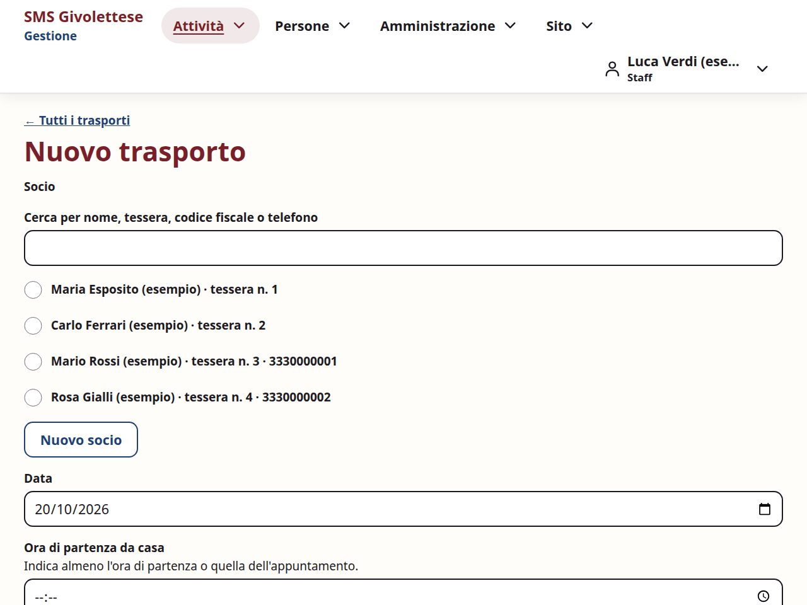

#### Assegnare l'autista

Apri il trasporto dal calendario. In alto, nel riquadro **Stato**, premi **Assegna autista**: l'elenco mostra i volontari che possono guidare, con l'etichetta *Disponibile*, *Già impegnato*, *Assente* o *Non disponibile in quell'orario*. Scegli l'autista e il **mezzo**. L'autista riceve un'email.

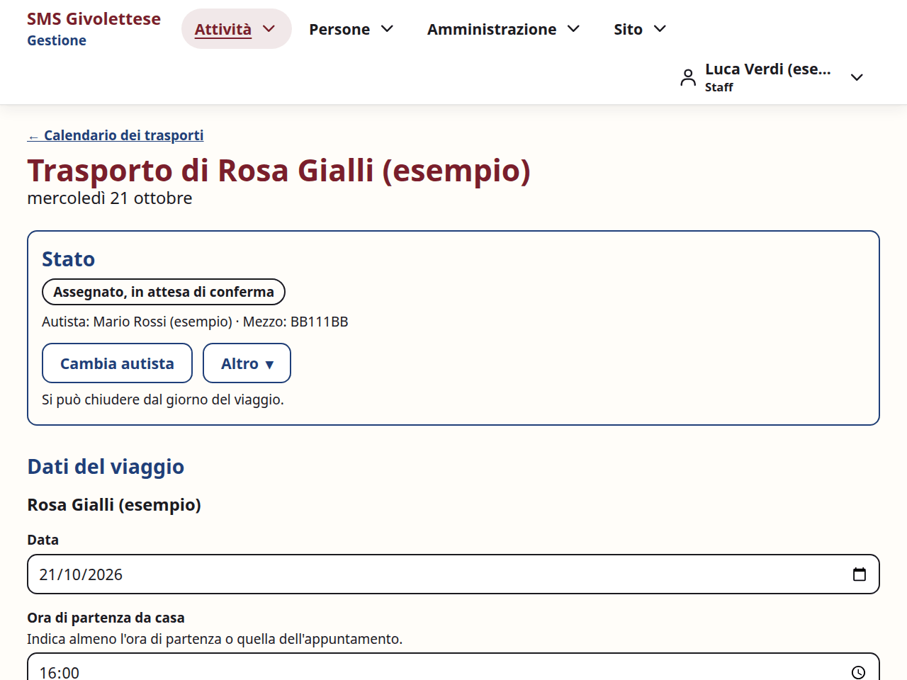

Sotto **Altro ▾** trovi:

- **Togli l'autista**: il trasporto torna *Da assegnare*.
- **Foglio di viaggio (PDF)**: da stampare e dare all'autista.
- **Annulla trasporto**.

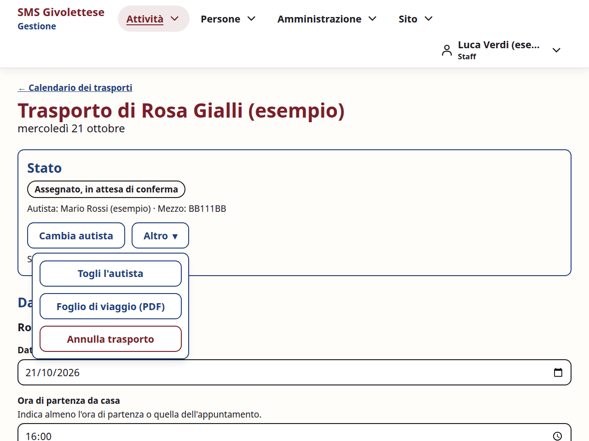

#### Chiudere e fatturare

Di solito chiude l'autista dalla sua agenda. Se non lo fa, dal giorno del viaggio puoi chiudere tu con **Chiudi con i km**: chilometri del contachilometri alla partenza e all'arrivo. I km si calcolano da soli.

Su un trasporto **Svolto** premi **Emetti fattura**. L'importo è già proposto (km × tariffa al km delle *Impostazioni*) ma lo puoi cambiare. Controlla codice fiscale e indirizzo del socio, scegli se è **già pagata** e conferma.

<table>
<tr>
<td width="50%">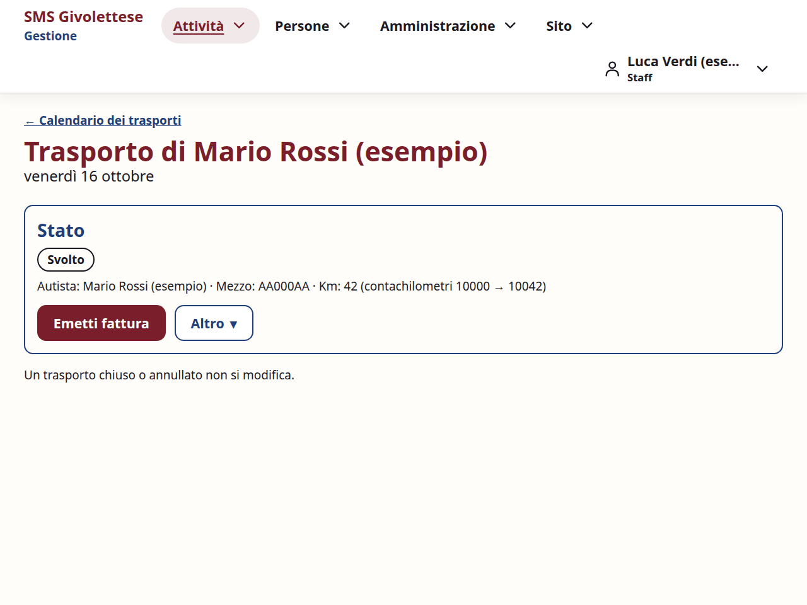</td>
<td width="50%">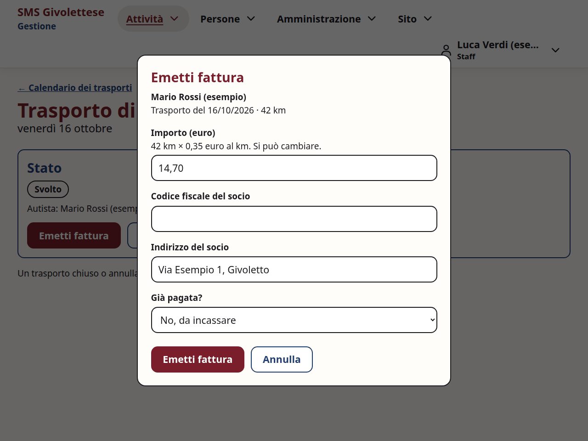</td>
</tr>
</table>

Un trasporto chiuso o annullato non si modifica più. Un trasporto si fattura una volta sola; se annulli la fattura, torna fatturabile.

#### Riepilogo mensile

In fondo al calendario, **Riepilogo mensile**: scegli il mese e premi **Scarica il riepilogo (CSV)**. Si apre con Excel o LibreOffice.

### 4.2 Turni

**Attività → Turni** è il calendario dei turni in sede, al centralino, in ambulatorio e così via. In alto tre contatori: **Scoperti**, **Parziali**, **Coperti**.

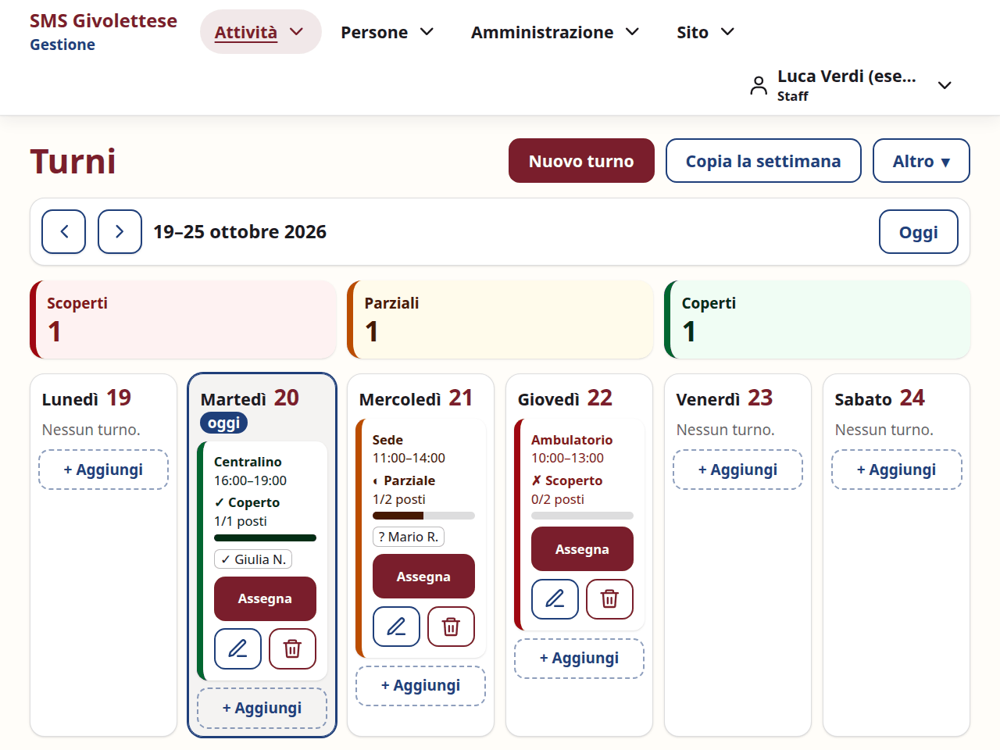

Ogni turno mostra tipo, orario, posti occupati (per esempio *1/2 posti*) e i volontari: ✓ ha confermato, ? deve ancora rispondere.

- **Creare un turno**: **Nuovo turno**, oppure **+ Aggiungi** sotto il giorno. Scegli il **Tipo di turno**, l'orario e quanti **Volontari richiesti**. Le note sono lette dai volontari: niente dati personali o sanitari.
- **Assegnare**: premi **Assegna** sul turno. L'elenco dei volontari dice chi è disponibile, già impegnato o assente e quanti impegni ha nel mese, così distribuisci il lavoro in modo equo. Il volontario riceve un'email e deve confermare.
- **Modificare o eliminare**: la matita ✎ e il cestino 🗑 sul turno.
- **Copia la settimana**: ricopia tutti i turni della settimana in un'altra (scegli un giorno qualsiasi della settimana di arrivo). I volontari non vengono copiati e i turni già presenti non si duplicano.
- **Altro ▾ → Tipi di turno**: aggiungi, rinomina, disattiva i tipi (*Sede*, *Centralino*, *Ambulatorio*, *Accompagnamento*…).

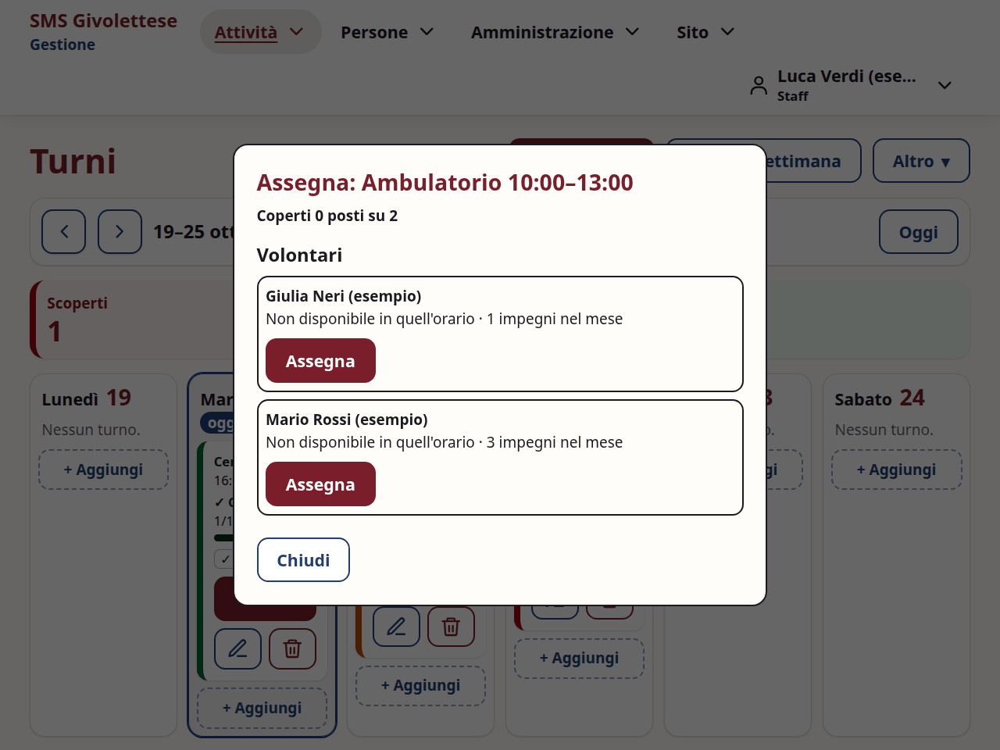

### 4.3 Disponibilità volontari

**Attività → Disponibilità volontari** mostra, giorno per giorno, chi ha detto di essere libero e in che orario. È lo stesso calendario, in sola lettura: ti serve per pianificare prima di assegnare.

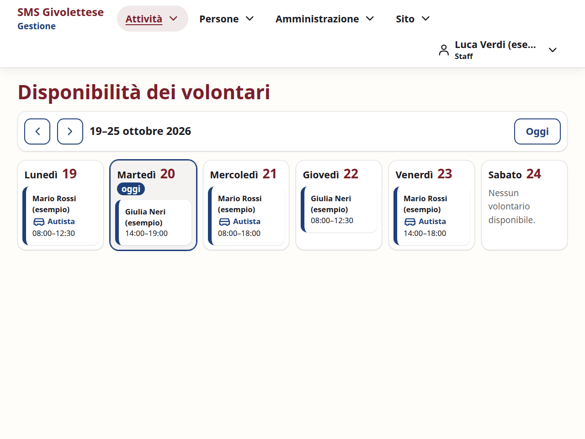

---

## 5. Persone: soci e volontari

### Soci

**Persone → Soci** è il libro soci. I riquadri in alto sono anche filtri: **Soci attivi**, **Quota *anno* da pagare**, **Cessati**, **Tutti**. Cerca per nome, tessera o telefono. **Esporta CSV** scarica l'elenco.

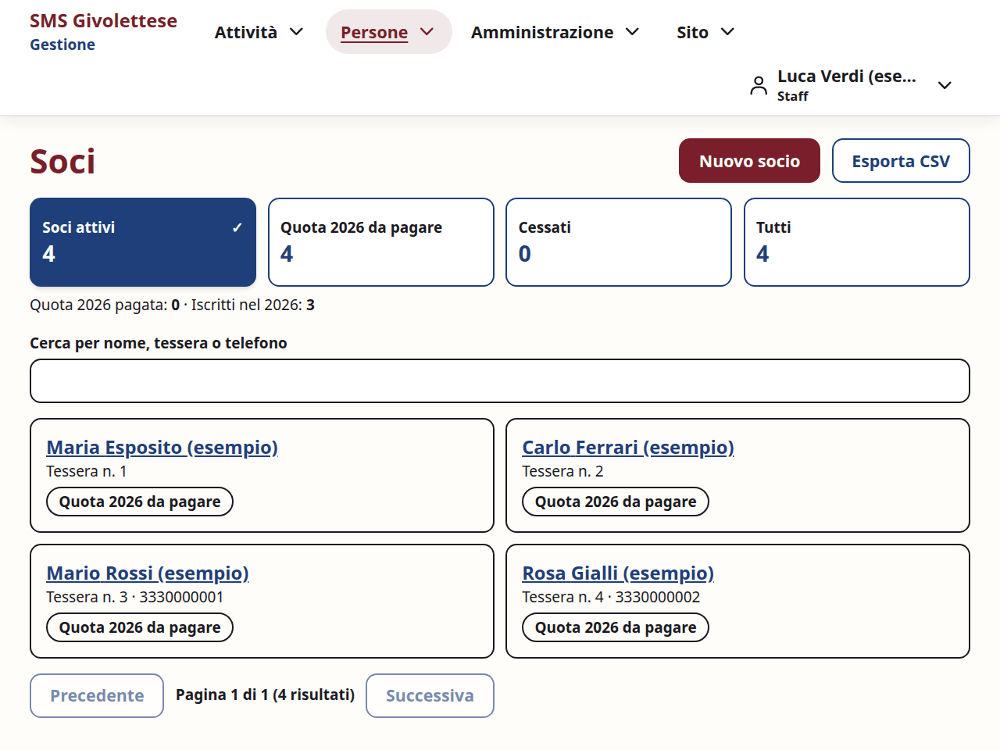

**Nuovo socio.** Premi **Nuovo socio**, compila i dati (nome, cognome, codice fiscale, nascita, indirizzo, telefono, email, tipo di socio: *Ordinario*, *Familiare*, *Sostenitore*, *Onorario*), la data di firma della privacy e, se l'ha già pagata, la quota. Premi **Registra socio**. Il numero di tessera si assegna da solo e non cambia più. Il codice fiscale viene controllato; se è giusto ma il controllo lo rifiuta (capita in rari casi), puoi salvarlo lo stesso.

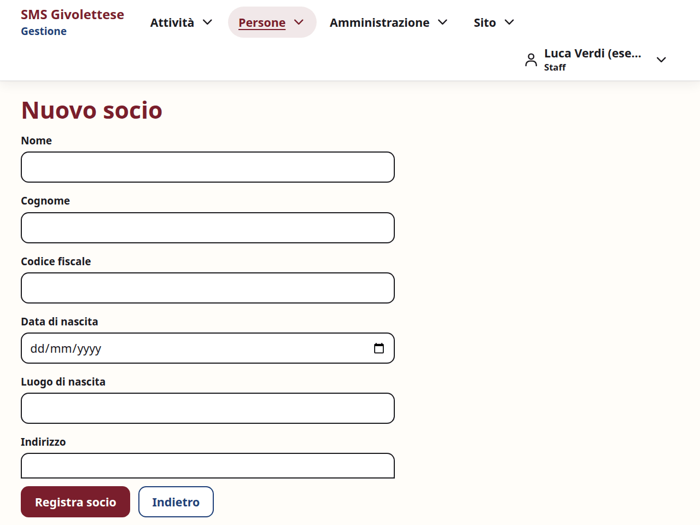

**La scheda del socio** raccoglie tutto: dati, **Quote versate** (con la **Ricevuta PDF** di ognuna), **Trasporti** e **Fatture**. Da qui:

- **Registra quota *anno***: importo e come ha pagato. Poi scarichi la ricevuta.
- **Nuovo trasporto**: già compilato con il socio.
- **Modifica dati**.
- **Cessa iscrizione**: scegli il motivo (*Dimissioni*, *Decesso*, *Mancato pagamento della quota*, *Esclusione*, *Trasferimento*) e la data. Il numero di tessera resta nel libro soci. Un socio cessato si può riattivare.

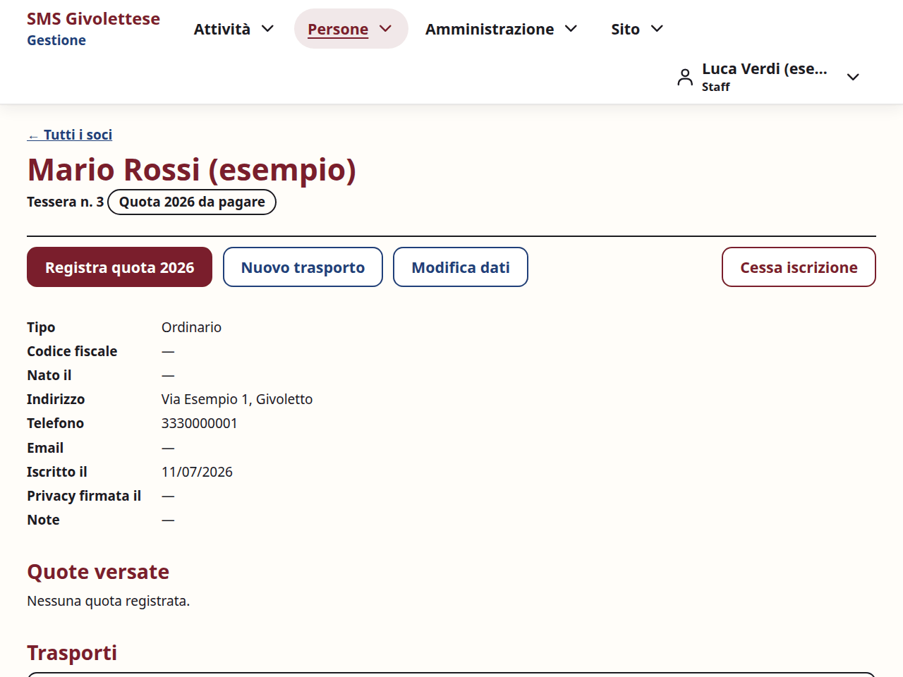

### Volontari

**Persone → Volontari** elenca i volontari (*Attivi* / *Non attivi*), con email, telefono e se possono guidare.

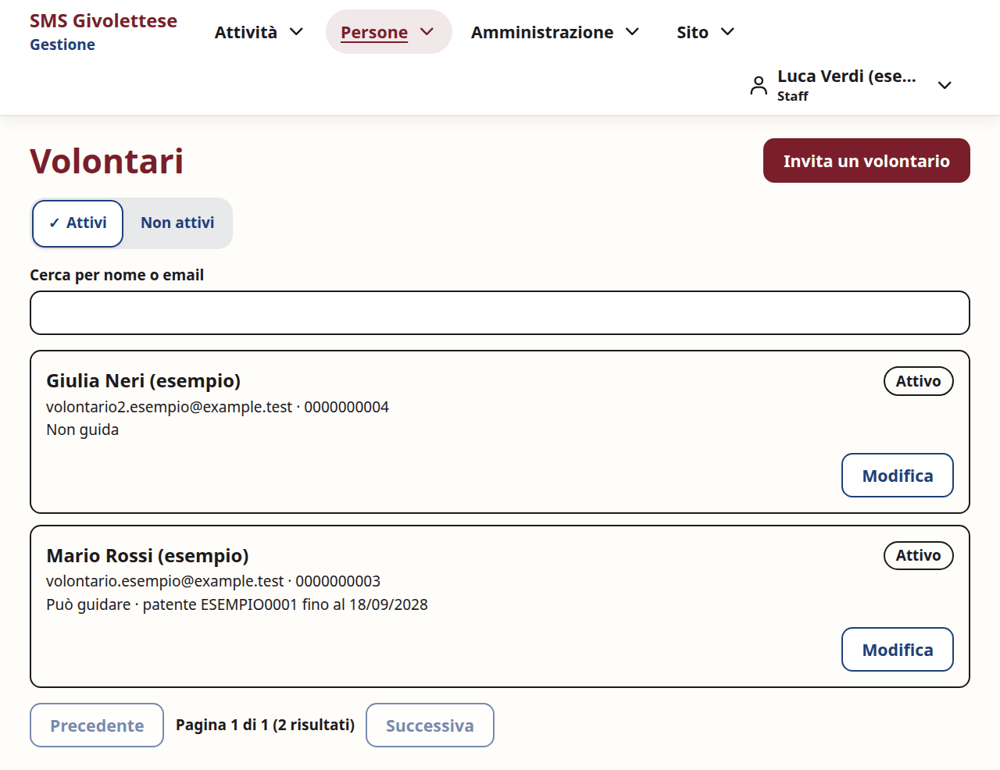

- **Invita un volontario**: nome, cognome, email, telefono. Spunta **Può guidare (trasporti)** e indica **Numero di patente** e **Scadenza della patente**. Il volontario riceve l'email per scegliere la password.
- **Modifica**: aggiorna i dati e la patente; togli la spunta **Attivo** per disattivare il volontario. Solo chi può guidare, con la patente valida, compare tra gli autisti dei trasporti.

---

## 6. Amministrazione

### Fatture

**Amministrazione → Fatture**: scegli l'**Anno** e vedi *Fatture emesse*, *Totale fatturato*, *Incassato*, *Da incassare*. Filtri *Tutte*, *Da incassare*, *Pagate*, *Annullate* e ricerca per socio o numero.

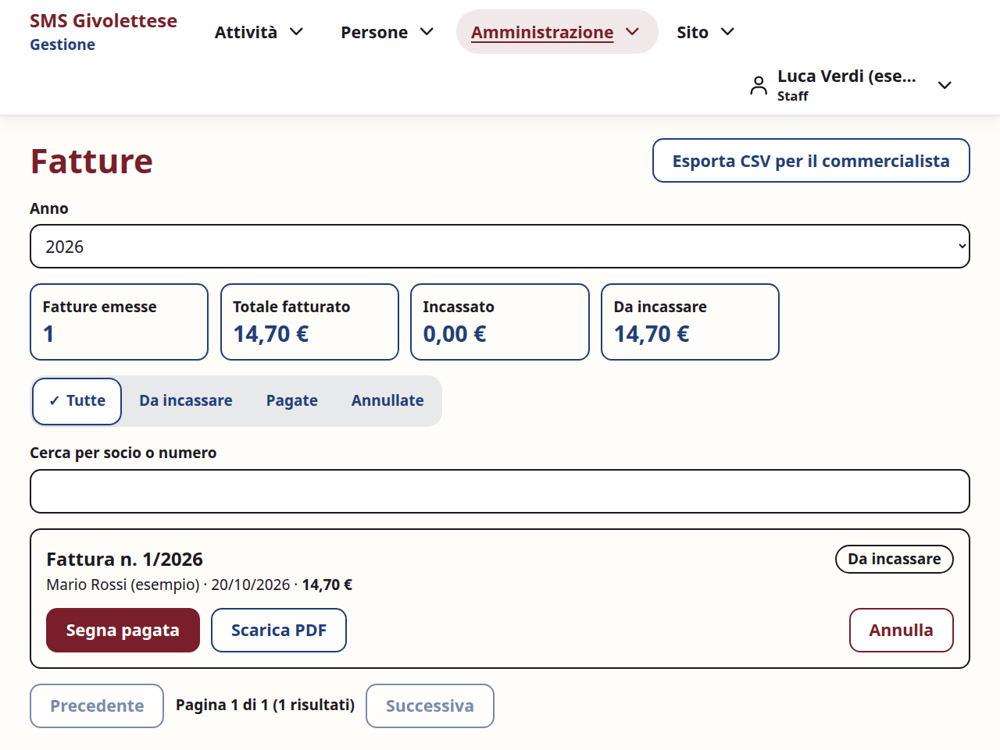

Su ogni fattura:

- **Segna pagata**: scegli come ha pagato.
- **Scarica PDF**: la fattura pronta da stampare o inviare, con intestazione, testo di esenzione IVA e bollo quando serve.
- **Annulla**: chiede il motivo. Il numero non viene riusato e il trasporto torna fatturabile.

**Esporta CSV per il commercialista** scarica tutte le fatture dell'anno in un file che si apre con Excel.

Le fatture si creano solo dai trasporti svolti ([vedi sopra](#chiudere-e-fatturare)). La numerazione riparte ogni anno e non ha buchi.

### Servizi

**Amministrazione → Servizi**: l'elenco dei servizi mostrato sul sito pubblico. **Nuovo servizio** per aggiungerne uno, **Modifica** per cambiare nome, descrizione e "quando" (per esempio *martedì mattina*) o disattivarlo.

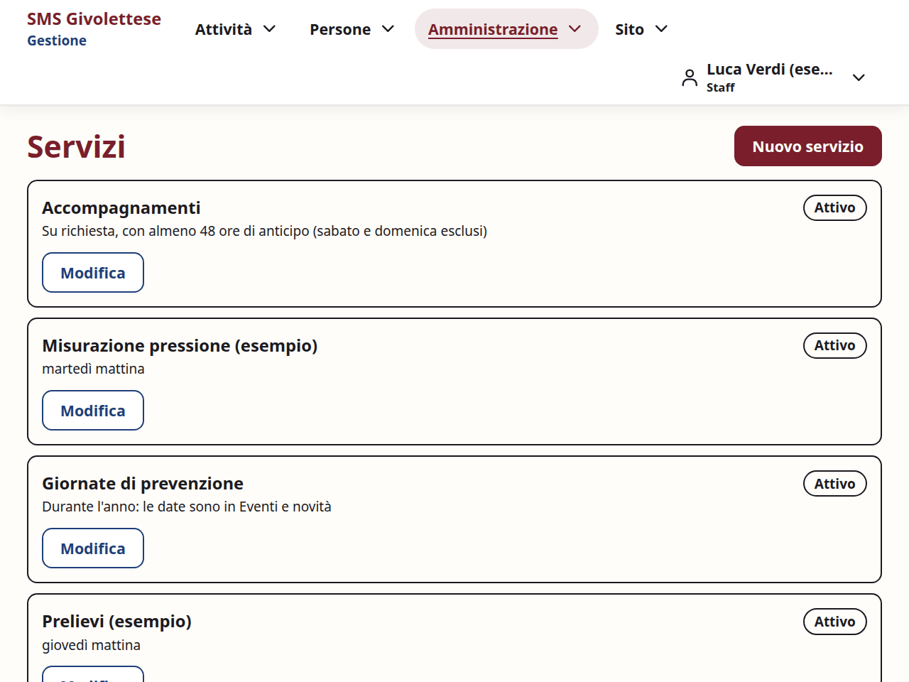

### Mezzi

**Amministrazione → Mezzi**: i veicoli dell'associazione con targa, modello, posti e se sono adatti alla carrozzina. **Aggiungi un mezzo**, **Modifica**, **Disattiva** (un mezzo non in uso non compare più nei trasporti).

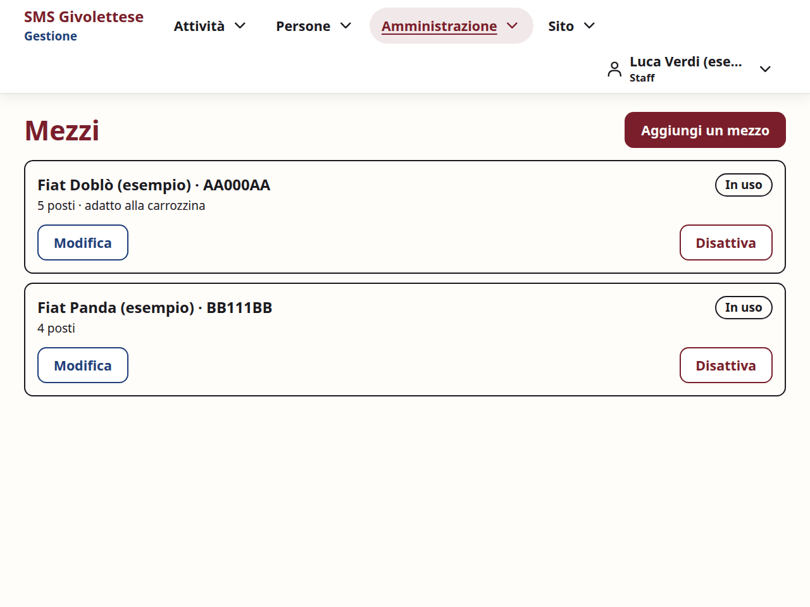

### Impostazioni

**Amministrazione → Impostazioni** raccoglie i valori che il gestionale usa ovunque:

- **Intestazione**: denominazione, codice fiscale, indirizzo (compaiono sulle fatture).
- **Fatture e bollo**: testo di esenzione IVA, soglia e importo del bollo.
- **Quota**: quota annuale di iscrizione.
- **Trasporti**: importo per ogni chilometro (per esempio 0,35 €), usato per proporre l'importo della fattura.
- **Sito**: dimensione massima dei video caricati.
- **Numerazioni**: ultimo numero di tessera e di fattura usati. I numeri possono solo aumentare.

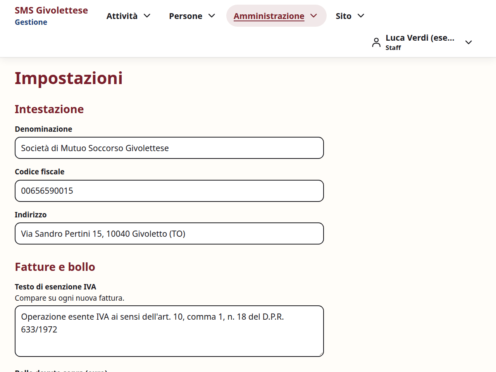

---

## 7. Sito: bacheca, proposte e testi

### Bacheca

**Sito → Bacheca** contiene gli articoli di *Eventi e novità*. Filtri *Tutti*, *Bozze*, *Pubblicati*. La scheda **Proposte** mostra quante proposte del pubblico aspettano.

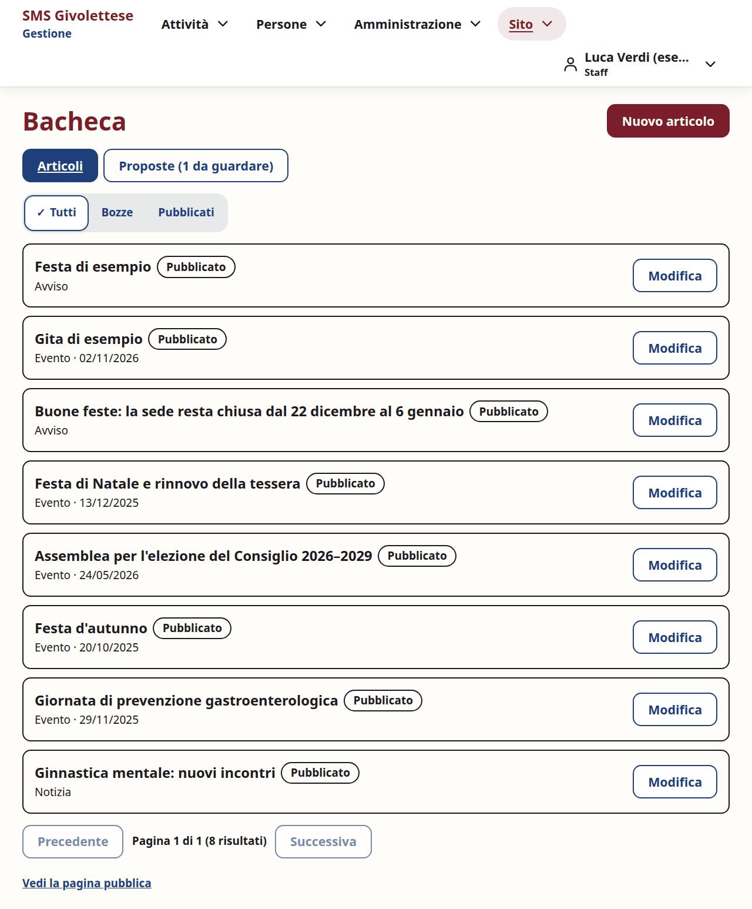

**Scrivere un articolo**

1. Premi **Nuovo articolo**.
2. Scrivi il **Titolo** e scegli il **Tipo**: *Evento*, *Avviso* o *Notizia*. Per gli eventi la **Data dell'evento** è obbligatoria; il **Luogo** è facoltativo.
3. Con **Carica foto** aggiungi la foto di copertina: compare nell'elenco, in home e in **Galleria**. Le foto vengono ridotte da sole prima del caricamento.
4. Scrivi il **Testo** come in Word. La barra in alto ha titoli, **grassetto**, *corsivo*, sottolineato e i pulsanti **+ Foto**, **+ Galleria**, **+ Video** (caricato o link YouTube/Vimeo), **+ Pulsante**, **+ Linea**. In alternativa scrivi `/` su una riga vuota.
5. **Salva la bozza** per continuare dopo, **Anteprima** per vederlo come sul sito, **Pubblica** per metterlo online.

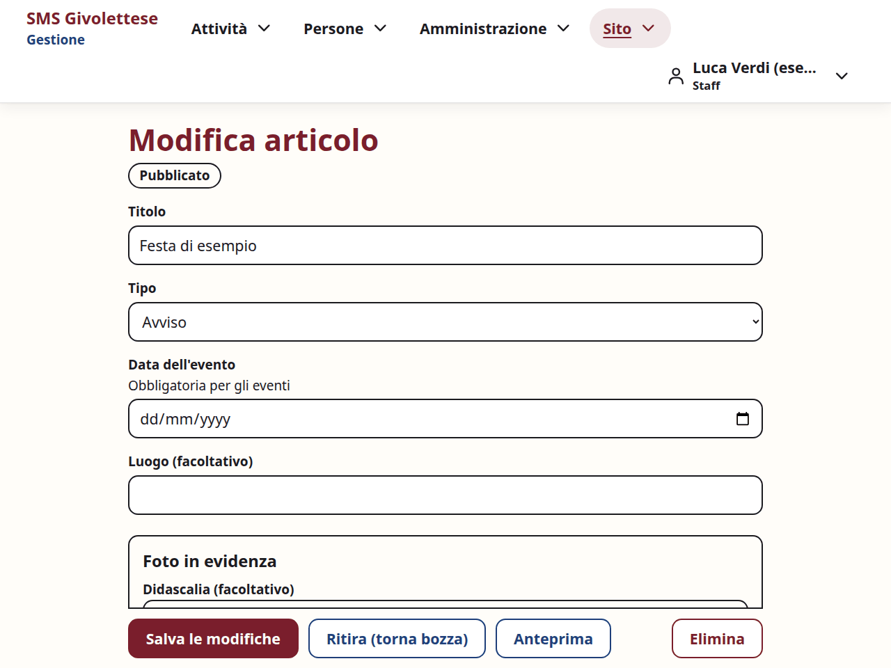

Su un articolo pubblicato: **Salva le modifiche**, **Ritira (torna bozza)** per toglierlo dal sito, **Elimina**.

#### Proposte dal pubblico

Apri la scheda **Proposte** e una proposta *Da guardare*. Leggi chi l'ha mandata e il testo, poi scegli:

- **Pubblica così**: diventa subito un articolo pubblicato.
- **Apri nell'editor**: diventa una bozza da sistemare prima di pubblicarla.
- **Scarta**: non viene pubblicata.

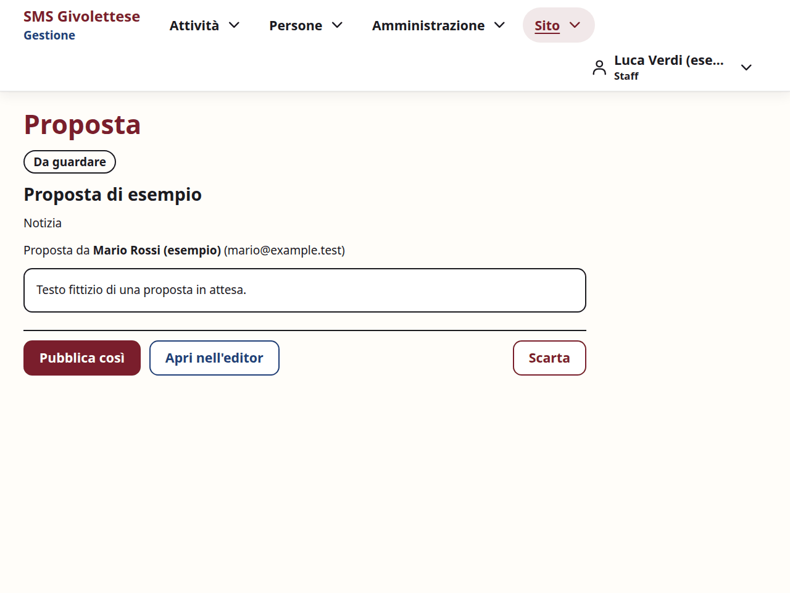

### Modifica il sito

**Sito → Modifica il sito** mostra le pagine pubbliche così come le vede un visitatore. Scegli la pagina con le schede (**Pagina iniziale**, **Chi siamo**, **Servizi**, **Convenzioni**, **Dove siamo**, **Privacy**), poi:

1. **Clicca su un testo** (è contornato da un tratteggio) e cambialo. Una riga vuota separa i paragrafi.
2. Aggiungi o togli riquadri, foto, convenzioni e link del piè di pagina con i pulsanti che compaiono.
3. Premi **Salva e pubblica**. Le modifiche sono online entro pochi istanti. **Annulla modifiche** torna all'ultima versione salvata.

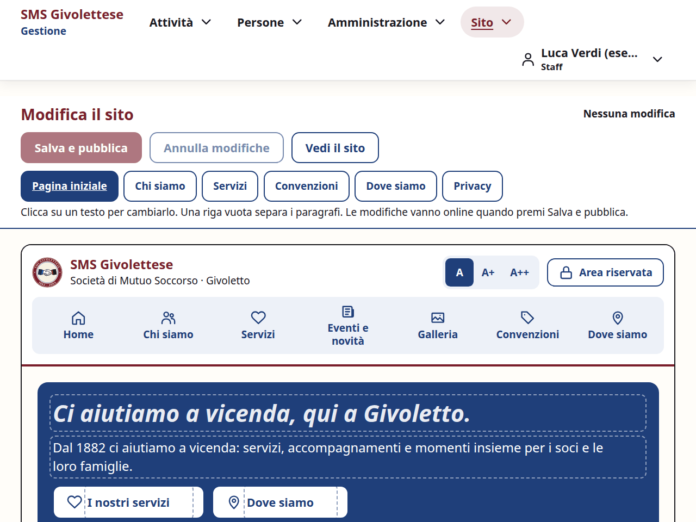

**Scorciatoia.** Quando sei entrato come staff e navighi il sito pubblico, in cima a ogni pagina compare *Sei nello staff: **Modifica questa pagina***: ti porta dritto al punto giusto.

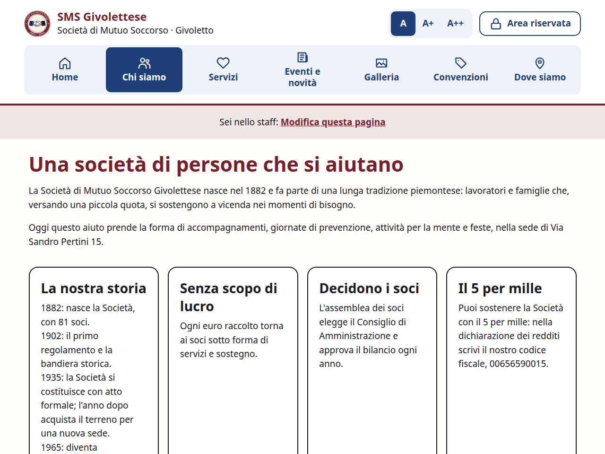

---

## 8. Guida per il super admin

Il super admin ha tutto quello dello staff e in più il gruppo **Super admin** nel menu.

### Utenti e ruoli

Qui gestisci tutti gli account. Filtra per stato (*Attivi*, *Disattivati*, *Tutti*) e per ruolo, o cerca per nome o email.

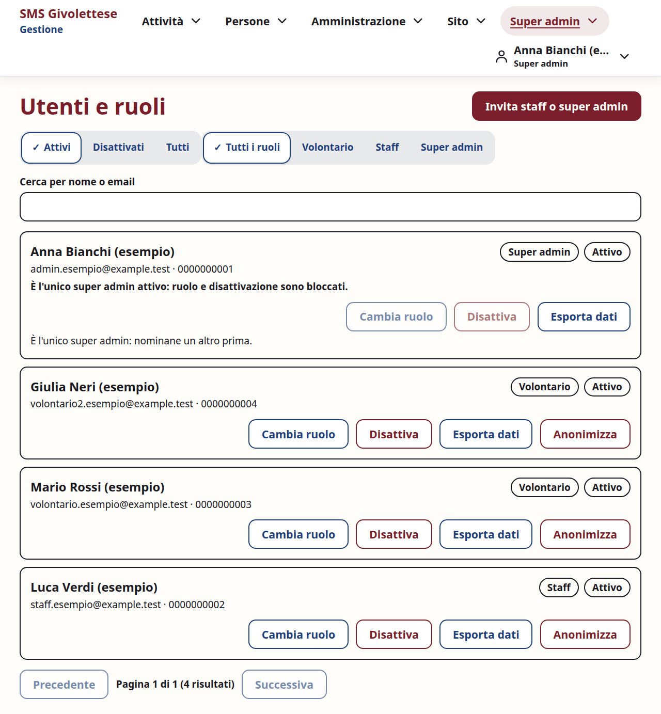

- **Invita staff o super admin**: la persona riceve l'email per scegliere la password. (I volontari li invita lo staff da *Volontari*.)
- **Cambia ruolo**: volontario, staff o super admin.
- **Disattiva** / **Riattiva**: chi è disattivato non può più entrare; i suoi dati restano.
- **Esporta dati**: scarica tutti i dati personali di quella persona (diritto di accesso GDPR).
- **Anonimizza**: cancella per sempre i dati personali, lasciando intatte fatture e storico. **Non si può tornare indietro.**

Gli stessi pulsanti **Esporta dati** e **Anonimizza** sono anche sulla scheda di ogni socio; un socio si anonimizza solo dopo averlo cessato.
- **Azzera** l'autenticazione a due fattori di qualcuno che ha perso il telefono.

Deve esserci sempre almeno un super admin attivo: l'ultimo non può essere disattivato né cambiare ruolo. Nominane un altro prima.

### Registro attività

Ogni modifica a soci, trasporti, fatture, impostazioni e utenti viene registrata: **chi** ha fatto **cosa** e **quando**. Filtra per tabella, azione, intervallo di date o codice della riga; **Vedi i dettagli** mostra i valori prima e dopo. Il registro non si può modificare.

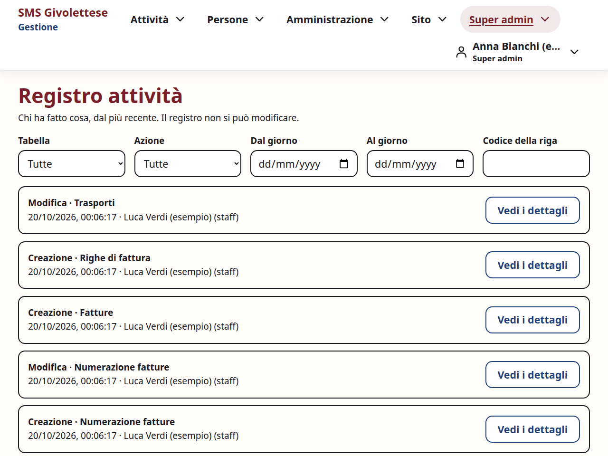

### Sicurezza dell'account

Dal menu con il tuo nome, **Sicurezza (due fattori)**: configura un'app di autenticazione sul telefono (Google Authenticator, Microsoft Authenticator…). Oltre alla password servirà un codice di 6 cifre. Consigliamo due dispositivi, perché non esistono codici di recupero.

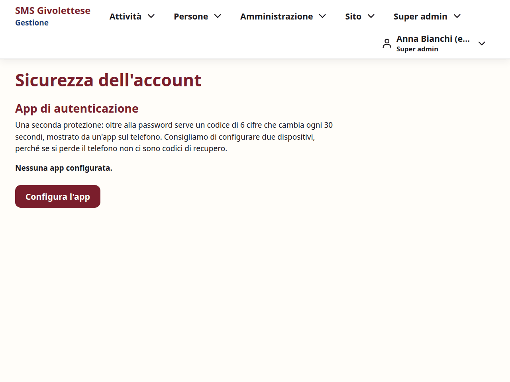

---

## 9. Per chi sviluppa

Repository unico con tre cartelle:

```
smsgivolettese/
  smsg-api/        API Hono su Vercel; schema del database, migrazioni, RLS (Supabase, UE)
  smsg-web/        sito e gestionale (Next.js App Router, Tailwind)
  smsg-workspace/  Makefile, documentazione, script, secrets.env
```

**Tecnologie**: TypeScript strict, Zod su ogni input, Supabase Auth con ruoli nel JWT, permessi in `smsg-api/src/auth/permissions.ts` replicati dalle policy RLS, PDF generati lato server, editor BlockNote, test con Vitest e Playwright.

**Avvio in locale** (prerequisiti: Node.js 24, pnpm, Docker senza sudo, Supabase CLI):

```bash
cd smsg-workspace
make setup        # dipendenze e .env.local
make dev          # Supabase + API :3001 + sito :3000
make db-demo      # (facoltativo) utenti e dati di esempio
```

Poi apri http://localhost:3000. Con `make db-demo` puoi entrare come `staff.esempio@example.test`, `volontario.esempio@example.test` o `admin.esempio@example.test`, password `Esempio-Locale-123!` (solo in locale).

| Comando | A cosa serve |
|---|---|
| `make test` | lint, typecheck e test di API e sito |
| `make e2e` | test Playwright sullo stack avviato |
| `make db-reset` | ricrea il database locale (migrazioni + seed reale, nessun utente) |
| `make superadmin` | crea il primo super admin da `secrets.env` |
| `make gen-api` | rigenera il client del sito dopo modifiche all'API |
| `make manual-shots` | rigenera le immagini di questo manuale (poi `make db-reset superadmin` per tornare puliti) |

Documentazione tecnica in [`smsg-workspace/docs/`](smsg-workspace/docs/): [architettura](smsg-workspace/docs/architecture.md), [modello dati](smsg-workspace/docs/data-model.md), [permessi](smsg-workspace/docs/permissions.md), [decisioni (ADR)](smsg-workspace/docs/decisions.md), [roadmap](smsg-workspace/docs/roadmap.md), [deploy](smsg-workspace/docs/deploy.md). Guida passo passo all'ambiente: [`smsg-workspace/README.md`](smsg-workspace/README.md).

---

## 10. Domande frequenti

**Non trovo un volontario tra gli autisti.**
Controlla in *Volontari* che sia attivo, che abbia **Può guidare** e la patente non scaduta, e che quel giorno non sia segnato assente.

**Ho sbagliato una fattura.**
Annullala (con il motivo) e riemettila dal trasporto. Il numero annullato resta nello storico e non viene riusato.

**Ho cambiato un testo del sito ma non lo vedo.**
Hai premuto **Salva e pubblica**? Le modifiche compaiono entro pochi istanti; ricarica la pagina.

**Un volontario non riceve l'email di invito.**
Controlla l'indirizzo in *Volontari* e fagli guardare nella cartella spam. Poi può usare *Inviami il link* nella pagina Accedi.

**Ho perso il telefono con l'app di autenticazione.**
Chiedi a un altro super admin di usare **Azzera** su *Utenti e ruoli*.

**Come tolgo i dati di una persona che lo chiede?**
Il super admin apre *Utenti e ruoli* (per un account) o la scheda del socio (dopo averlo cessato): **Esporta dati** se la persona li vuole, poi **Anonimizza**.
