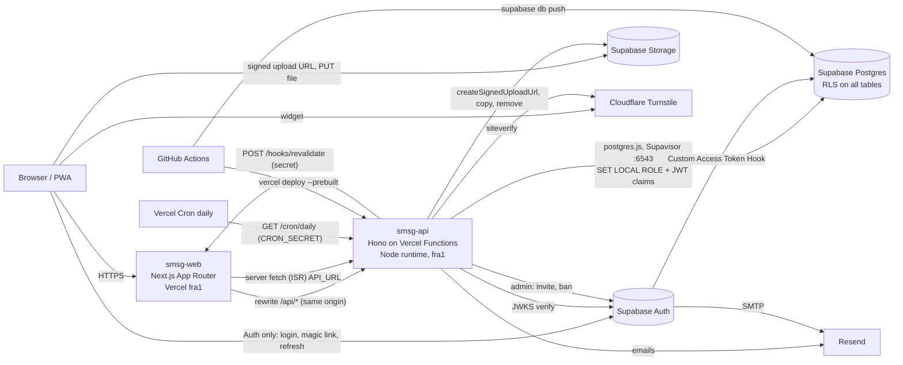

# Architecture

## Components



Environments:

| | local | staging | production |
|---|---|---|---|
| Supabase | CLI (`supabase start`, Docker) | existing project `ydqdnicpfspqewclqrgk` | existing project `vcpmnpsfcgebhmgqlqeu` |
| API | `localhost:3001` | `staging` branch deploy, fixed alias (e.g. `api-staging.<domain>`) + PR previews | `main` → prod domain |
| Web | `localhost:3000` (rewrite → 3001) | every PR / non-main branch preview, `API_URL` = staging API | `main` → prod domain |
| Email | Supabase Inbucket / Resend test key | Resend (test domain) | Resend (verified domain) |

Free-tier notes: Supabase pauses inactive projects after a week (daily cron keeps prod alive; staging may need unpausing); Storage max file 50 MB; Auth built-in SMTP is rate-limited → configure Resend SMTP in both projects.

## Repositories

```
smsg-workspace/            orchestration only
  api/  web/               git submodules
  docs/                    brief, prototype, architecture, data-model, permissions, roadmap, decisions, deploy (phase 8)
  Makefile  .env.example  README.md  .claude/
smsg-api/                  layout exactly as in brief.md §smsg-api, plus:
  openapi.json             committed snapshot (contract)
  vercel.json              crons, fra1, git.deploymentEnabled.main=false
  .github/workflows/ci.yml, deploy.yml
smsg-web/                  layout as in brief.md §smsg-web, plus:
  app/hooks/revalidate/route.ts   ISR webhook (NOT under /api)
  proxy.ts                 (Next 16 name of middleware.ts)
  lib/api/schema.d.ts      generated, committed
  public/manifest.webmanifest, icons
```

API module list (`src/modules/*`): `health`, `public` (services, posts, settings, booking submit, proposal submit + upload URL), `me` (profile, availability, commitments), `bookings`, `clients`, `members`, `invoices`, `services`, `settings`, `posts`, `proposals`, `media`, `shifts`, `transports`, `volunteers`, `vehicles`, `users`, `audit`, `gdpr`, `cron`. Layers: routes → service → repo (one-way). PDFs (invoice, fee receipt, travel sheet) rendered in services with `pdfkit`, streamed, never stored.

## Request and auth flow
1. Login in the browser with `@supabase/ssr` (`signInWithPassword` for staff/admin, `signInWithOtp({shouldCreateUser:false})` for volunteers, optional password set at `/imposta-password`). Session in cookies.
2. Custom Access Token Hook (`public.custom_access_token_hook`, granted to `supabase_auth_admin`) adds `app_role` from `user_roles` when `profiles.active`.
3. `web/proxy.ts` refreshes the session and guards `/gestione/**` by role (`supabase.auth.getClaims()`), see `permissions.md`.
4. Client calls go through `openapi-fetch` to `/api/...` with `Authorization: Bearer <access_token>` (middleware on the client reads the session). Vercel rewrites `/api/:path*` → `${API_URL}/:path*`.
5. API `auth` middleware verifies the JWT with `jose` against `${SUPABASE_URL}/auth/v1/.well-known/jwks.json` (cached), extracts `sub`, `app_role`. Missing/invalid token on a protected route → 401.
6. `requirePermission(action)` → 403. Zod validates params/body/query (`@hono/zod-openapi`).
7. Repo runs inside `db.asUser(claims, fn)`: `sql.begin(async tx => { await tx\`select set_config('request.jwt.claims', ${json}, true), set_config('role','authenticated', true), set_config('app.request_id', ${id}, true)\`; … })`. Public endpoints use `db.asAnon`, cron/invites `db.asService`. `postgres(DATABASE_URL, { prepare: false })` (transaction pooler).
8. Critical writes call SQL functions (`issue_invoice`, `register_member`, `submit_public_booking`, …); exclusion/unique/check violations are mapped to domain errors.

## Signed upload flow
1. `POST /media/upload-url {kind: image|video, mime, size}` (staff) or `POST /public/proposals/upload-url` (anon, Turnstile, image only, ≤ 5 MB). API checks mime whitelist (`image/webp`, `image/jpeg`, `image/png`, `video/mp4`, `video/webm`) and size (`org_settings.video_max_mb` for video). Returns `{ bucket, path, token, signedUrl }` from `storage.from(bucket).createSignedUploadUrl(path)`; path = `<yyyy>/<uuid>.<ext>`.
2. Browser resizes images first (long side ≤ 2000 px, WebP), then `uploadToSignedUrl` directly to Storage. Files never pass through Vercel.
3. `POST /media/complete {bucket, path, width, height, alt}` → API checks object exists and real size/mime via Storage `info`, then inserts the `media` row. Proposal photo path is sent with the proposal instead.
4. Buckets: `media` (public read, `file_size_limit` 50 MB, allowed mime types set on bucket), `proposals` (private; staff view via signed read URL). Publishing a proposal copies its photo into `media`. Orphans: daily cron deletes `media`-bucket objects older than 24 h without a `media` row (shortcut acceptable at this scale).
Web serves images with `next/image` (`remotePatterns` = Supabase Storage host). Videos: uploaded file (`<video>`) or YouTube/Vimeo embed (privacy-enhanced `youtube-nocookie.com`, URL whitelist).

## OpenAPI contract flow
- Routes defined with `@hono/zod-openapi`; `GET /openapi.json` served by the API; `info.version` semver.
- `pnpm openapi:export` writes `openapi.json` (committed). API CI: (a) regenerate and `git diff --exit-code`; (b) `oasdiff breaking` against `main`'s `openapi.json` — breaking changes fail unless the major version is bumped.
- Web: `pnpm gen:api` → `openapi-typescript ${OPENAPI_URL:-http://localhost:3001/openapi.json} -o lib/api/schema.d.ts` (committed); `make gen-api` exports `api/openapi.json` first and passes it as `OPENAPI_URL` (ADR-033). Web CI typechecks against the committed file.
- Rule: ship API changes backward-compatible (add, then remove after web is deployed); then deploy order between repos does not matter.

## ISR revalidation
- Public pages are Server Components fetching `${API_URL}` with `next: { tags: [...] }` and `revalidate: 3600` fallback. Tags: `posts`, `post:<slug>`, `services`, `site-settings`.
- After publish/update/unpublish/delete of posts, writes to services or site_settings, the API service calls `POST ${WEB_URL}/hooks/revalidate` with header `x-revalidate-secret: ${REVALIDATE_SECRET}` and body `{ tags: string[] }` (2 s timeout, failure logged, never fails the write). The route handler checks the secret (constant-time) and calls `revalidateTag(tag)` (use the Next 16 signature with immediate expiry).
- Not under `/api/*`: that prefix is rewritten to the API.

## Errors, logging, audit
- Domain errors in `src/lib/errors.ts`: `ValidationError` 400, `Unauthorized` 401, `Forbidden` 403, `NotFound` 404, `Conflict` 409, `RateLimited` 429, else 500. Body `{ error: { code, message, details? } }`, `message` in Italian for end users, `code` stable UPPER_SNAKE.
- Postgres mapping in one place: `23P01` → `COMMITMENT_OVERLAP` 409; `23505` → by constraint name (e.g. `members_tax_code_key` → `MEMBER_TAX_CODE_EXISTS`) 409; `P0001` with message = code (`DRIVER_NOT_ELIGIBLE`, `LAST_SUPER_ADMIN`, `BOOKINGS_NOT_INVOICEABLE`, `INVOICE_IMMUTABLE`, …) 409/422; `42501` (RLS) → 403.
- Logs: `src/lib/logger.ts`, one JSON line per event via `console` (`level, msg, requestId, method, route, status, durationMs, role`). No names, emails, phones, tax codes, bodies or tokens. `x-request-id` echoed in responses.
- Audit: DB triggers (`data-model.md` §audit_log) — captures every write including SQL-function writes, actor from JWT claims, `request_id` from `app.request_id`. Viewable/filterable at `/gestione/registro-attivita` (`GET /audit?table=&actor=&from=&to=`).

## Public endpoints protection
`/public/bookings`, `/public/proposals*`: Turnstile token (`cf-turnstile-response` in body) verified server-side, one token per call; rate limit per IP via `app.consume_rate_limit` (e.g. 5 bookings / 10 min / IP, 3 proposals / hour / IP). Client IP from `x-real-ip` / first `x-forwarded-for` (to verify behind the web rewrite in phase 3; fall back to Vercel Firewall rate limit if not available). Web sets CSP (Turnstile, Supabase, YouTube/Vimeo frames), HSTS, `frame-ancestors 'none'`.

## Notifications and cron
- On assignment (shift or transport) the service sends a Resend email after commit (failure logged, not fatal).
- `vercel.json` cron `0 16 * * *` (UTC ≈ 17–18 Rome) → `GET /cron/daily` with `Authorization: Bearer ${CRON_SECRET}`: reminders for tomorrow's `proposto|confermato` assignments and `assegnato|confermato` transports where `reminder_sent_at is null` (set after send → idempotent), rate-limit table cleanup, orphan media cleanup.

## Environment variables (overview; each repo ships a documented `.env.example`)
| Var | api | web | Notes |
|---|---|---|---|
| `DATABASE_URL` | ✔ | | Supavisor transaction pooler (6543) |
| `SUPABASE_URL` | ✔ | ✔ (`NEXT_PUBLIC_SUPABASE_URL`) | |
| `SUPABASE_SECRET_KEY` | ✔ | | service role / `sb_secret_…`; API only |
| `NEXT_PUBLIC_SUPABASE_PUBLISHABLE_KEY` | | ✔ | anon / `sb_publishable_…` |
| `TURNSTILE_SECRET_KEY` / `NEXT_PUBLIC_TURNSTILE_SITE_KEY` | ✔ | ✔ | test keys locally |
| `RESEND_API_KEY`, `EMAIL_FROM` | ✔ | | |
| `CRON_SECRET` | ✔ | | |
| `REVALIDATE_SECRET` | ✔ | ✔ | |
| `WEB_URL` | ✔ | | revalidation + email links + invite redirect |
| `API_URL` | | ✔ | rewrite target + server fetch |
| `SUPERADMIN_EMAIL`, `SUPERADMIN_PASSWORD` | ✔ (script) | | workspace `secrets.env`, used only on creation |
| `SUPABASE_DB_PASSWORD_{STAGING,PROD}` | | | workspace `secrets.env` (local CLI); GitHub secrets in CI |
| `LOG_LEVEL` | ✔ | | |
| CI secrets | `SUPABASE_ACCESS_TOKEN`, `SUPABASE_DB_PASSWORD_{STAGING,PROD}`, `SUPABASE_{STAGING,PROD}_REF`, `VERCEL_TOKEN`, `VERCEL_ORG_ID`, `VERCEL_PROJECT_ID` | | |

## CI/CD
- Both repos: GitHub Actions on PR and `main`: `pnpm lint`, `tsc --noEmit`, tests (API integration tests start local Supabase in CI).
- API PR touching `supabase/migrations`: `supabase db push` to **staging** (staging may be reset with `supabase db reset --linked`; demo data only).
- API `main`: tests → `supabase db push` to **production** → `vercel deploy --prebuilt --prod`. Vercel Git auto-deploy for `main` is disabled in the API project so the DB is always migrated first. Previews still auto-deploy and use staging env.
- Web: Vercel Git integration (previews per PR, prod on `main`). Preview deployments reach the staging API through the rewrite; API staging alias must be exempt from Vercel Deployment Protection (or use the protection-bypass header).
- Pushes to GitHub are manual, by the owner, when everything is stable; `main` push = production release.

## Open questions
1. ~~Supabase refs and region~~ resolved: `smsg-prod` `vcpmnpsfcgebhmgqlqeu`, `smsg-staging` `ydqdnicpfspqewclqrgk`, both `eu-central-1` (EU).
2. Vercel plan: Hobby terms are for non-commercial personal use; confirm the association's account/plan (Pro if required).
3. Client IP availability behind the external rewrite (rate limiting) — verify in phase 3.
4. GDPR retention of invoices and of the members' register — confirm with the privacy officer (ADR-026).
