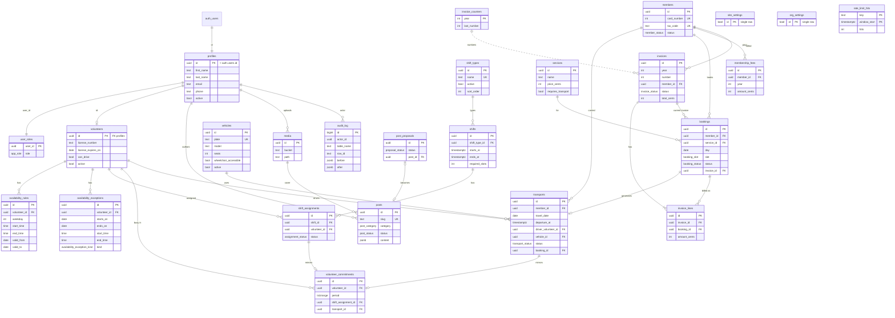

# Data model

Postgres (Supabase), schema `public` for tables, schema `app` for private helper functions (not exposed). All migrations hand-written in `smsg-api/supabase/migrations`.

Conventions (ADR-001, ADR-013):
- Table/column names **English**, snake_case. Enum **values** stay Italian (domain vocabulary from the brief, shown in the UI, `volontario` is mandated in the JWT claim).
- PK `id uuid default gen_random_uuid()` unless stated. `created_at timestamptz not null default now()`, `updated_at` maintained by `extensions.moddatetime` on mutable tables.
- Money as **integer euro cents** (`*_cents int`, project convention), never float; formatted only in UI/PDF. Instants `timestamptz`; calendar days `date`; local wall-clock `time` interpreted in `Europe/Rome`.
- RLS **enabled on every table** (policies: see `permissions.md`).

Glossary: socio (also the person served; "assistito" no longer exists, ADR-060) → `members`, quota → `membership_fees`, turno → `shifts`, tessera → `card_number`, fascia → `slot`, bollo → `stamp_duty`, bacheca → `posts`.

## ER diagram

## Enums

| Postgres enum | Values (order matters only for `app_role`) |
|---|---|
| `app_role` | `volontario`, `staff`, `super_admin` (ascending: `role >= 'staff'` = "at least staff") |
| `assignment_status` | `proposto`, `confermato`, `rifiutato` |
| `transport_status` | `richiesto`, `assegnato`, `confermato`, `svolto`, `annullato` |
| `booking_status` | `attesa`, `confermata`, `eseguita`, `annullata` |
| `booking_origin` | `online`, `telefono` |
| `booking_slot` | `mattina` (8–12), `pomeriggio` (14–18) |
| `member_type` | `ordinario`, `familiare`, `sostenitore`, `onorario` |
| `member_status` | `attivo`, `cessato` |
| `member_end_reason` | `dimissioni`, `decesso`, `mancato_pagamento`, `esclusione`, `trasferimento` |
| `payment_method` | `contanti`, `pos`, `bonifico` |
| `invoice_status` | `emessa`, `pagata`, `annullata` |
| `post_category` | `evento`, `avviso`, `notizia` |
| `post_status` | `bozza`, `pubblicata` |
| `proposal_status` | `attesa`, `pubblicata`, `rifiutata` |
| `availability_exception_kind` | `assente`, `extra` |
| `audit_action` | `insert`, `update`, `delete` |

## Tables

### Identity
**profiles** — `id uuid PK references auth.users(id) on delete restrict`, `first_name text not null`, `last_name text not null`, `email text not null` (copy of auth email, for lists), `phone text`, `active bool not null default true`, `anonymized_at timestamptz`, timestamps. Created by the API on invite / bootstrap (no profile trigger on `auth.users`; the only trigger there records `app.password_set`, ADR-034).

**user_roles** — `user_id uuid PK references profiles(id)`, `role app_role not null`, `updated_at`. One role per user (ADR-005). Trigger `user_roles_protect_last_super_admin` (see invariants).

### Volunteers
**volunteers** — `id uuid PK references profiles(id)`, `license_number text`, `license_expires_on date`, `can_drive bool not null default false`, `notes text`, `active bool not null default true`, timestamps. `check (not can_drive or license_expires_on is not null)`.

**vehicles** — `plate text not null unique` (upper, no spaces: `check (plate = upper(replace(plate,' ','')))`), `model text not null`, `seats smallint not null check (seats between 1 and 9)`, `wheelchair_accessible bool not null default false`, `active bool not null default true`.

**availability_rules** — `volunteer_id uuid not null FK volunteers on delete cascade`, `weekday smallint not null check (weekday between 1 and 7)` (ISO, 1 = Monday), `start_time time not null`, `end_time time not null check (end_time > start_time)`, `valid_from date not null default current_date`, `valid_to date check (valid_to >= valid_from)`. Index `(volunteer_id, weekday)`. UI "Mattina/Pomeriggio" = 08:00–12:00 / 14:00–18:00 rows. Saving the weekly grid replaces the volunteer's open-ended rules in one transaction (`PUT /me/availability`).

**availability_exceptions** — `volunteer_id FK cascade`, `starts_on date not null`, `ends_on date not null check (ends_on >= starts_on)`, `start_time time`, `end_time time` (both null = whole day; `check ((start_time is null) = (end_time is null))`), `kind availability_exception_kind not null`, `note text`. "Non ci sono" = one `assente` row over a date range. Index `(volunteer_id, starts_on)`.

**shift_types** — `name text not null unique`, `active bool default true`, `sort_order int default 0`. Seed: Sede, Centralino, Ambulatorio, Accompagnamento.

**shifts** — `shift_type_id uuid not null FK`, `starts_at timestamptz not null`, `ends_at timestamptz not null check (ends_at > starts_at)`, `required_slots smallint not null check (required_slots >= 1)`, `notes text`, `created_by uuid FK profiles`. Index `(starts_at)`.

**shift_assignments** — `shift_id FK cascade`, `volunteer_id FK volunteers`, `status assignment_status not null default 'proposto'`, `responded_at timestamptz`, `assigned_by uuid FK profiles`, `reminder_sent_at timestamptz`, `unique (shift_id, volunteer_id)`. Index `(volunteer_id)`.
View **shift_coverage** (`shift_id, filled, required_slots, coverage` where `filled` = count of `proposto|confermato`; coverage `scoperto` (0) / `parziale` / `coperto`).

**volunteer_commitments** — see invariant 1. `volunteer_id FK`, `period tstzrange not null`, `shift_assignment_id uuid unique FK cascade`, `transport_id uuid unique FK cascade`, `check (num_nonnulls(shift_assignment_id, transport_id) = 1)`. Written only by triggers.

### Transports
**transports** — `member_id uuid not null FK members` (ADR-060), `requested_by text` (who asked, free text), `travel_date date not null`, `departure_at timestamptz`, `appointment_at timestamptz`, `return_at timestamptz`, `from_address text`, `to_address text`, `reason text` (generic purpose only, UI hint: no health details), `wheelchair bool not null default false`, `companion bool not null default false`, `notes text` (staff only), `driver_volunteer_id uuid FK volunteers`, `vehicle_id uuid FK vehicles`, `status transport_status not null default 'richiesto'`, `km numeric(6,1) check (km >= 0)`, `driver_notes text`, `completed_at timestamptz`, `booking_id uuid unique FK bookings`, `reminder_sent_at timestamptz`, `created_by uuid FK profiles`, timestamps.
Checks:
- `status in ('assegnato','confermato','svolto') ⇒ driver_volunteer_id, departure_at, from_address, to_address not null`
- `status = 'richiesto' ⇒ driver_volunteer_id is null`
- `status = 'svolto' ⇒ km is not null`
- `return_at is null or return_at > departure_at`
Indexes `(travel_date)`, `(driver_volunteer_id, travel_date)`, `(member_id)`.
Trigger `require_active_member` (BEFORE INSERT on `transports` and `bookings`, ADR-060): the member must be `attivo`, else `P0001 MEMBER_NOT_ACTIVE` (422). Updates are not checked (a later `cessato` member's bookings can still be executed, restored, invoiced).
Busy period (ADR-015): `tstzrange(departure_at, coalesce(return_at, appointment_at + interval '1 hour', departure_at + interval '2 hours'), '[)')`.
Trigger `bookings_create_transport` (AFTER INSERT on `bookings`, security invoker, ADR-043): when the service `requires_transport`, inserts a `richiesto` row (`booking_id`, `member_id`, `travel_date = day`) with null addresses/times; staff completes it.
Trigger `bookings_sync_transport` (AFTER UPDATE OF `status` on `bookings`, security invoker, ADR-046): to `annullata` → linked transport `annullato` unless `svolto|annullato`; from `annullata` → an `annullato` linked transport back to `richiesto` with `driver_volunteer_id`, `vehicle_id` null. Booking member/service/day/slot are not editable (cancel and re-create), so no other branch.

**volunteer_transports_v** (view, minimisation — `permissions.md`): `id, travel_date, departure_at, appointment_at, return_at, from_address, to_address, wheelchair, companion, status, km, driver_notes, member_first_name, member_last_name, member_phone, vehicle_plate, vehicle_model` (join `members`) filtered `driver_volunteer_id = auth.uid() and status in ('assegnato','confermato','svolto')`.

### Bookings, services
No `clients` table: every person booked, transported or invoiced is a member (ADR-060).

**services** — `name text not null`, `description text`, `price_cents int not null check (>= 0)` (single price, members only, ADR-060; staff/invoices only; anon has no column grant, ADR-044), `schedule_note text` ("quando", e.g. "martedì mattina"), `active bool default true` (shown on site, offered in the staff booking form), `requires_transport bool default false`, `sort_order int default 99`. (`bookable` dropped, ADR-043.)

**bookings** — `member_id uuid not null FK members`, `service_id uuid not null FK`, `day date not null`, `slot booking_slot not null`, `time time` (set on confirmation), `price_applied_cents int not null` (snapshot of `services.price_cents` at creation), `origin booking_origin not null` (always `telefono` since ADR-043, desk included), `status booking_status not null default 'attesa'` (created `confermata` when a time is given, else `attesa`; transitions ADR-046), `notes text`, `invoice_id uuid FK invoices` (current non-void invoice; cleared on void), `executed_at timestamptz`, `cancelled_by text check in ('staff','utente')`, `created_by uuid FK profiles`, timestamps. `check (invoice_id is null or status = 'eseguita')`. Indexes `(day)`, `(member_id)`, `(invoice_id)` (phase 4), partial `(status) where status in ('attesa','confermata')`.

### Members
**members** — `card_number int not null unique` (tessera, never reused), `first_name`, `last_name text not null`, `tax_code text unique check (~ '^[A-Z0-9]{16}$')` (NULLs allowed; checksum validated in the API with explicit "save anyway"), `birth_date date`, `birth_place text`, `address text`, `postal_code text check (~ '^\d{5}$')`, `city text`, `phone text`, `email text`, `member_type member_type not null default 'ordinario'`, `joined_on date not null`, `status member_status not null default 'attivo'`, `ended_on date`, `end_reason member_end_reason`, `privacy_signed_on date`, `notes text`, `anonymized_at`, timestamps. `check ((status = 'cessato') = (ended_on is not null))`. Index `(last_name, first_name)`. BEFORE UPDATE OF `card_number` trigger raises `CARD_NUMBER_IMMUTABLE` (phase 4).

**membership_fees** — `member_id FK`, `year smallint not null check (year between 2000 and 2100)`, `amount_cents int not null check (>= 0)`, `paid_on date not null`, `method payment_method not null`, `recorded_by uuid FK profiles`, **`unique (member_id, year)`**. Receipt PDF rendered on demand.

### Invoices
**invoice_counters** — `year smallint PK`, `last_number int not null default 0 check (>= 0)`.

**invoices** — `year smallint not null`, `number int not null`, **`unique (year, number)`**, `issued_on date not null`, `member_id uuid not null FK members`, snapshot columns `customer_name`, `customer_tax_code`, `customer_address`, `issuer_name`, `issuer_tax_code`, `issuer_address`, `vat_exemption_text text not null`, `subtotal_cents`, `stamp_duty_cents`, `total_cents int not null` (`check (total_cents = subtotal_cents + stamp_duty_cents)`), `status invoice_status not null`, `payment_method payment_method`, `paid_on date`, `voided_at timestamptz`, `voided_by uuid`, `void_reason text`, `created_by uuid`, timestamps. Checks: `status='pagata' ⇒ payment_method, paid_on not null`; `status='annullata' ⇒ voided_at not null`. Display number `"{number}/{year}"`. Indexes `(member_id)`, `(status)`.

**invoice_lines** — `invoice_id FK cascade`, `booking_id uuid FK bookings`, `position smallint not null`, `description text not null`, `amount_cents int not null check (>= 0)`, `unique (invoice_id, position)`.

### Bacheca and media
**media** — `bucket text not null check (bucket in ('media','proposals'))`, `path text not null`, `mime text not null`, `size_bytes bigint not null`, `width int`, `height int`, `alt text`, `uploaded_by uuid FK profiles` (null for public proposals), `created_at`, `unique (bucket, path)`. Row inserted only after the upload is verified (`architecture.md` §Uploads).

**posts** — `slug text not null unique check (slug ~ '^[a-z0-9]+(-[a-z0-9]+)*$')` (≤ 80; frozen once `published_at` is set, trigger raises `SLUG_FROZEN`; unpublish keeps `published_at`), `title text not null` (≤ 200), `category post_category not null`, `event_date date`, `location text` (≤ 200), `cover_media_id uuid FK media`, `content jsonb not null default '[]'` (`check jsonb_typeof = 'array'`; BlockNote blocks, whitelist validated by Zod on write), `excerpt text` (≤ 260 chars, derived), `status post_status not null default 'bozza'`, `author_id uuid FK profiles`, `published_at timestamptz` (`check (status='bozza' or published_at is not null)`), `from_proposal_id uuid unique FK post_proposals on delete set null`, timestamps. `posts_event_date_chk`: published `evento` needs `event_date`. Audited. Index `(status, published_at desc)`.

**post_proposals** — `title text not null`, `category post_category not null`, `event_date date`, `location text`, `body text not null` (≤ 3000), `photo_path text` (private bucket `proposals`), `video_url text`, `submitter_name text not null`, `submitter_contact text`, `status proposal_status not null default 'attesa'`, `post_id uuid FK posts on delete set null`, `reviewed_by uuid`, `reviewed_at`, `created_at`.

### Settings, infrastructure
**site_settings** (public, single row: `id bool PK default true check (id)`) — `address`, `slogan`, `home_intro`, `vat_number`, `conventions jsonb not null default '[]'` (`[{title, description, url?}]`), `footer_links jsonb not null default '[]'` (`[{group: associazioni|mutuo_soccorso|utili, label, url}]`), both `check (jsonb_typeof(..) = 'array')`, plus `site_settings_links_valid check (app.site_links_valid(conventions, footer_links))` (items are objects, non-empty `title`/`label`, valid `group`, `url ~ '^https://\S+$'`; ADR-051), `pages jsonb not null` (editable page texts, ADR-061: `{home: {servicesButton, whereButton, quote, quoteSource}, chiSiamo|privacy: {title, intro, sections: [{heading, body}]}, servizi|convenzioni|doveSiamo: {title, intro}}`, plain text, blank line = paragraph; `site_settings_pages_valid check (jsonb_typeof(pages) = 'object' and pages ?& array['home','chiSiamo','servizi','convenzioni','doveSiamo','privacy'])`, inner shape validated by Zod; seeded with the copy previously hardcoded in the web pages, privacy placeholders included), `updated_at`. No phone, email, opening hours or quota text (ADR-044). Only write path: `PUT /site-settings`.

**org_settings** (private, single row) — `legal_name`, `tax_code`, `address`, `vat_exemption_text default 'Operazione esente IVA ai sensi dell''art. 10, comma 1, n. 18 del D.P.R. 633/1972'`, `stamp_duty_threshold_cents int not null default 7747`, `stamp_duty_amount_cents int not null default 200`, `membership_fee_cents int not null default 2000`, `last_card_number int not null default 0`, `video_max_mb int not null default 50 check (video_max_mb between 1 and 50)` (Supabase free-tier cap), `updated_at`.

**rate_limit_hits** — `key text`, `window_start timestamptz`, `hits int`, PK `(key, window_start)`. Function `app.consume_rate_limit(key, max, window_seconds) returns bool` (upsert + compare). Rows older than 1 day are purged inside `consume_rate_limit` itself (no cron needed).

**audit_log** — `id bigint generated always as identity PK`, `at timestamptz default now()`, `actor_id uuid` (`auth.uid()`, null = system), `actor_role app_role`, `request_id text` (`current_setting('app.request_id', true)`), `action audit_action`, `table_name text`, `row_id text`, `before jsonb`, `after jsonb`, `redacted bool default false`. Indexes `(at desc)`, `(table_name, row_id)`, `(actor_id)`. Filled by generic trigger `app.audit()` (AFTER INSERT/UPDATE/DELETE, security definer) on: `profiles`, `user_roles`, `volunteers`, `services`, `site_settings`, `members`, `membership_fees`, `invoices`, `invoice_lines`, `invoice_counters`, `org_settings`, `shifts`, `shift_assignments`, `transports`, `posts`, `media` (insert/delete), `post_proposals` (update/delete, personal columns dropped via trigger arguments, ADR-066). `audit_action` also has `export`. Append-only: `audit_log_guard` allows only the GDPR redaction update (ADR-066/067).

## DB-enforced invariants

1. **No double booking of a volunteer** (ADR-004). Table `volunteer_commitments` with
   `constraint volunteer_commitments_no_overlap exclude using gist (volunteer_id with =, period with &&)` (`create extension btree_gist`).
   Security-definer triggers keep it in sync in the same transaction:
   - `shift_assignments` AFTER INSERT/UPDATE/DELETE: upsert row with `tstzrange(shift.starts_at, shift.ends_at, '[)')` when status ∈ {`proposto`,`confermato`}, else delete.
   - `shifts` AFTER UPDATE OF `starts_at, ends_at`: update periods of its commitments (a move that creates an overlap fails).
   - `transports` AFTER INSERT/UPDATE/DELETE: upsert when `driver_volunteer_id` not null and status ∈ {`assegnato`,`confermato`,`svolto`}, else delete.
   Violation → SQLSTATE `23P01`, API maps to 409 `COMMITMENT_OVERLAP`. Chosen over a trigger-only check (races under READ COMMITTED) and a materialized view (cannot reject the write).
2. **Driver eligibility**: BEFORE INSERT/UPDATE trigger `transports_check_driver` when `driver_volunteer_id` is not null: volunteer `active`, `can_drive`, `license_expires_on >= travel_date`; if `wheelchair` and `vehicle_id` set, vehicle must be `wheelchair_accessible`; vehicle must be `active`. Raises `P0001` with message `DRIVER_NOT_ELIGIBLE` / `VEHICLE_NOT_SUITABLE`. Trigger on `volunteers` UPDATE OF `can_drive, license_expires_on, active` rejects the change (`DRIVER_HAS_FUTURE_TRANSPORTS`) if it would invalidate future assigned transports.
3. **Uniqueness**: `members.card_number`, `members.tax_code`, `invoices (year, number)`, `membership_fees (member_id, year)`, `shift_assignments (shift_id, volunteer_id)`, `transports.booking_id`, `posts.slug`, `vehicles.plate`.
4. **Invoice numbering** — `public.issue_invoice(p_member_id uuid, p_booking_ids uuid[], p_customer_tax_code text, p_customer_address text, p_payment_method payment_method default null) returns invoices`, `security definer`, `set search_path = ''`:
   1. `app.require_role('staff')`; member missing → `MEMBER_NOT_FOUND` (any status may be invoiced);
   2. `select … from bookings where id = any(p_booking_ids) and member_id = p_member_id and status = 'eseguita' and invoice_id is null for update` — count mismatch → `BOOKINGS_NOT_INVOICEABLE`;
   3. `y := extract(year from now() at time zone 'Europe/Rome')`; `insert into invoice_counters(year) values (y) on conflict do nothing`; `select last_number from invoice_counters where year = y for update`; `n := last_number + 1`; update counter;
   4. snapshot `org_settings` + customer from the member (ADR-060): name `first_name || ' ' || last_name`, tax code `coalesce(p_customer_tax_code, tax_code)`, address `coalesce(p_customer_address, nullif(concat_ws(', ', address, nullif(concat_ws(' ', postal_code, city), '')), ''))`; `stamp_duty_cents := case when subtotal_cents > stamp_duty_threshold_cents then stamp_duty_amount_cents else 0 end`;
   5. insert invoice (+ `pagata`, `paid_on = today` if payment given), lines (`"{service} del dd/mm/yyyy"`, `price_applied_cents`), set `bookings.invoice_id`.
   Rollback after step 3 also rolls back the counter → no gaps from failures.
5. **Voided numbers never reused**: `public.void_invoice(id, reason)` (staff) only sets `annullata` + void fields and clears `bookings.invoice_id`; counters only increase; no DELETE policy on `invoices`/`invoice_lines` and BEFORE DELETE triggers raise `INVOICE_IMMUTABLE`; BEFORE UPDATE trigger allows only `emessa→pagata` (payment fields) and `emessa|pagata→annullata` (void fields), every other column immutable. Lines are insert-only (via `issue_invoice`).
6. **Member numbering** — `public.register_member(p jsonb, p_fee_method payment_method default null) returns members` (staff): `select last_card_number from org_settings for update`, `+1`, insert member, optional fee for current year at `membership_fee_cents`. Cessation/reactivation never touch the number.
7. **Counter adjustment** (super_admin, "numerazioni"): `app.set_member_counter(n)` requires `n >= max(card_number)`; `app.set_invoice_counter(year, n)` requires `n >= max(number) for year`. Upward only (ADR-025).
7b. **Staff view of org data** — `public.staff_org_info()` (security definer, `app.require_role('staff')`, granted to `authenticated`) returns `legal_name, tax_code, address, membership_fee_cents, stamp_duty_threshold_cents, stamp_duty_amount_cents, next_card_number (= last_card_number + 1)`; used for form defaults and fee receipts (ADR-049). Staff still have no direct read on `org_settings`.
8. **Stamp duty** config lives in `org_settings` (threshold/amount), snapshot per invoice so config changes never alter issued invoices.
9. **Last super admin**: BEFORE UPDATE/DELETE on `user_roles` and BEFORE UPDATE OF `active` on `profiles`: if the row is an active super_admin losing that status, `perform 1 from user_roles where role = 'super_admin' for update` then raise `LAST_SUPER_ADMIN` if no other active one remains.
10. **Proposal → post** one-to-one via `posts.from_proposal_id unique`.

## Public (anon) readable rows
| Table | anon `select` policy |
|---|---|
| `services` | `active = true`; column grant only `id, name, description, schedule_note, sort_order, active` (no prices, ADR-044) |
| `posts` | `status = 'pubblicata' and published_at <= now()` |
| `site_settings` | the single row (all columns are public by design) |
| `media` | `bucket = 'media'` (public bucket; metadata only) |
All other tables: no anon access. Anon writes only via `submit_post_proposal(...)` (security definer, `grant execute to anon`, phase 6), called by the API after Turnstile + rate limit (ADR-006). `submit_public_booking` was dropped (ADR-043).
